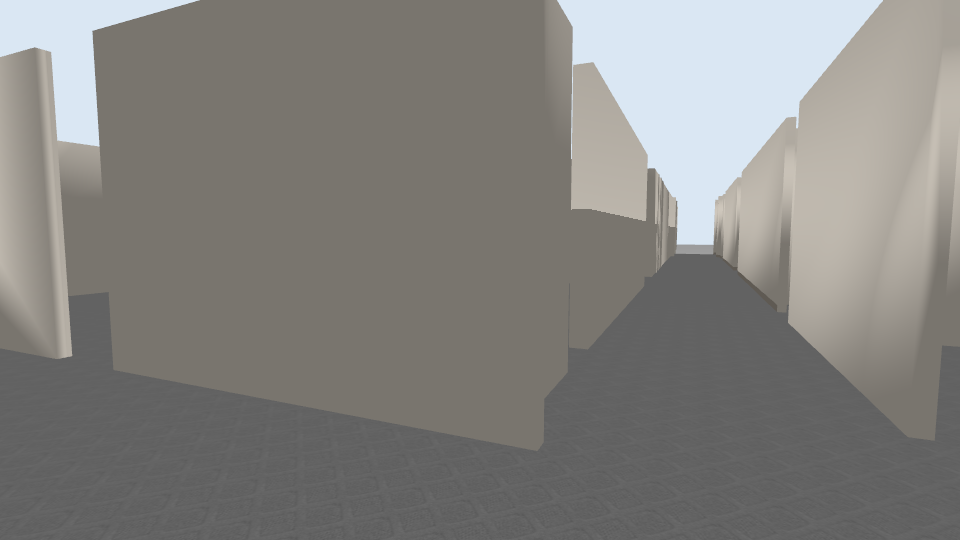

# WHILL 轮椅仿真与眼动控制

本仓库整合本机可恢复的轮椅仿真、EYETLE 眼动项目、ESP32／iPad 接口文档，以及针对 Ubuntu 24.04 / x86_64 / ROS 2 Jazzy / Gazebo Harmonic 重建的运行入口。

当前运行链路：双 USB 眼部相机 → RITnet ONNX + 原生 PuReST → 左中右标定与双眼眨眼事件 → ROS 眼动消息 → 仿真速度控制与激光前方停车 → Gazebo 办公室轮椅。真人佩戴完成标定后可试用；自动测试不等于已通过真人驾驶验收。



## 本机启动

```bash
cd ~/whill
./scripts/run_sim.sh          # 键盘：第一人称窗口按住 W/A/S/D
```

先关闭上一套仿真，再启动眼动：

```bash
cd ~/whill
./scripts/run_sim.sh --eye --recalibrate
```

眼动窗口依次提示看正中、左、右、回正中。保持头部不动、只转动眼睛看黄色圆点；有效稳定样本累计约 1.5 秒才进入下一步。标定成功后双眨眼前进，行进时看左右触发约 1 秒转向；闭眼、无效跟踪暂停，暂停后一次短眨眼恢复。持续丢失、急停或相机换会话会撤销授权，需要重新双眨眼。转向阈值 ±0.55，回中阈值 ±0.25，启动／恢复后视线缓冲 0.5 秒。

驾驶窗口空格急停，E 解除急停，Q / Esc 退出整套程序，终端 Ctrl+C 也会清理本次启动的进程。眼动模式下解除急停后需重新双眨眼。键盘松开约 250 ms 停车，独立底盘看门狗约 200 ms 未收到消息则发零速度。

本机默认左眼 `/dev/video4` 旋转 180°、右眼 `/dev/video2` 不旋转。USB 路径参与标定绑定，相机切换需重新标定。若左右装反，可用 `--left /dev/video2 --right /dev/video4`；单独检查或修改旋转：

```bash
./scripts/run_eye.sh --left /dev/video4 --right /dev/video2 \
  --left-rotation 180 --right-rotation 0 --recalibrate
./scripts/run_eye.sh --no-display --max-frames 60 --report local/camera-check.json
```

无显示诊断禁止发布运动控制和采集标定。标定保存在 `local/`，不进入 Git。默认 ROS domain 为 64、本机发现；`WHILL_ROS_DOMAIN_ID=87 ./scripts/run_sim.sh` 可隔离不同实验。

## 新机器安装

准备 Ubuntu 24.04 和 ROS 2 Jazzy，再执行：

```bash
./scripts/setup_ubuntu.sh
```

安装脚本建立 `.venv`、编译 PuReST、从保留的原始网格生成 Willow 办公室，并仅构建当前需要的 `wheelchair_interfaces` 和 `wheelchair_sim`。重建入口使用 ONNX Runtime CPU，未使用备份中与 Jetson 绑定的 TensorRT 引擎。

## 代码布局与恢复范围

| 路径 | 内容 |
|---|---|
| `runtime/whill_runtime` | 本次重建：眼动检测、引导标定、眨眼事件、仿真驾驶窗口 |
| `wheelchair_shared_ws/src/wheelchair_sim` | 原轮椅几何、物理世界、看门狗、第一人称画面；增加 Jazzy 兼容 |
| `wheelchair_shared_ws/src/wheelchair_interfaces` | 原 ROS 消息／服务定义 |
| `wheelchair_shared_ws/src/eye_shared_control` | 成功恢复的原眼动意图适配器和测试 |
| `projects/EYETLE` | 恢复的修改版代码／文档／模型，以及上游补齐的基础文件 |
| `projects/Ble2WChair` | iPad BLE HID 接口的可恢复文档、启动脚本；核心控制包未完整恢复 |
| `projects/*.md` | 原系统设计与实验文档；旧机器路径、旧测试数字不代表本机验证 |
| `reports` | 文件恢复清单和本机验证结果 |

备份部分源码读不到，另有全零文件。完整原样读取副本与错误日志保存在本机 `~/whill-recovery/`，不进入本仓库。清单中的 `zero_filled`／`unreadable` 条目没有被当作有效代码导入。旧版 `wheelchair_control` 的规划器、执行器、方向管理等核心文件损坏，当前入口使用新建的直接仿真驾驶控制，**尚未恢复原 Nav2 共享导航、自动转弯路径规划与全周避障**。当前只对激光前方近障做前进停车，物理碰撞由 Gazebo 处理；倒车、侧向扫掠不具备完整规划避障。

原始眼动 `tools/` 目录不可读，本次依照文档重建功能；采用完整画面 320×240 分割，未恢复原 TensorRT 动态 ROI／双帧批量优化。RITnet 四类原始 logits 从 ONNX 图内取出；导出模型默认两个通道实际打包标签和最大置信度。预处理依上游使用 gamma 0.8、CLAHE、均值／标准差 0.5。PuReST 为固定提交的原生 C++ 实现。

真实轮椅、ESP32、iPad 均未启动。仓库尚未配置远端或上传。

## 验证与来源

运行测试：

```bash
./scripts/test.sh
```

`scripts/validate_eye_sim.py` 使用**合成眼动事件**检查 ROS → 控制 → Gazebo 位移、转向和停车，需要先运行独立的新仿真和 `python3 -m whill_runtime.console --mode eye --no-display`。相机诊断和合成事件验证分别记录，不将合成事件视作真实眼动识别结果。

测试使用独立 ROS domain 97，避免与正在运行的摄像头／仿真混入同一话题。

来源、版本、许可证与实际验证见 [本机恢复说明](docs/LOCAL_REPRODUCTION.md)。PuReST 带非商业／学术使用条款，各上游许可证保留在原目录；本项目不以单一许可证覆盖所有第三方代码和场景。
