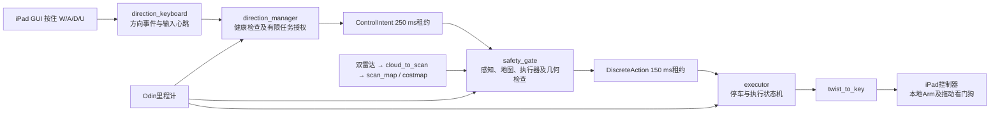

# 当前键盘无法驱动轮椅的原因与超时机制

## 结论与证据范围

分析日志：`logs/hardware_keyboard_20261026_201210.log`，2026-10-26 20:12:10–20:13:23（UTC+8）。启动方式：

```bash
script -q -e -f -c 'WHEELCHAIR_ROS_DOMAIN_ID=0 ROS_LOCALHOST_ONLY=0 ./scripts/run_hardware_keyboard.sh' "logs/hardware_keyboard_$(date +%Y%m%d_%H%M%S).log"
```

日志证明按键已到达控制链，但运动授权被健康检查拒绝。主要表现是地图、扫描时效不满足，并非键盘消息没有发送。聚类滤波已加载，双雷达输入正确；当前日志不能证明聚类效果，也不能证明延迟由聚类造成。本次仅分析和同步现有代码，没有调整超时或发布运动命令。

一个值得优先排查的配置不一致：硬件安全门控的扫描年龄阈值为380 ms，而scan_map只接受300 ms以内的扫描。本日志决策记录中的扫描年龄中位数约318 ms，存在“扫描在安全门控仍新鲜，但到建图时已被拒收”的时间区间。年龄测量发生在不同节点、不同时间，不能直接把安全门控采样等同于scan_map实际丢帧次数。

## 最新日志说明了什么

- 第79行：`Single-frame cluster filter: radius 1 m, link 5 cm, min 4 points per sensor`。
- 第84行：`lidar_mode=both`，输入为两台`/mid360_20{1,2}/points_filtered`。
- 第531–534行：W事件3已发出，返回`NOT_HEALTHY`。
- 第564–567行：A事件5返回`LOWER_HEALTH_TIMEOUT_OR_FAULT`。
- 第580–584行：W事件7返回`LOWER_HEALTH_TIMEOUT_OR_FAULT`。
- 第692–695行：W事件10返回`LOWER_HEALTH_TIMEOUT_OR_FAULT`。

493条安全门控JSON记录中，`intent_enabled`均为false，`action`均为STOP。这证明这些记录没有授权运动；不是物理运动测量，也不代表日志涵盖每一个控制周期。门控按原因变化等条件输出，以下次数不是故障持续时间或周期占比。

| 原因（包含READY_TO_REARM后缀） | 记录数 |
|---|---:|
| MAP_STALE_OR_INCOMPLETE | 358 |
| SCAN_STALE_OR_INVALID | 115 |
| USER_EMERGENCY_STOP | 11 |
| INITIAL_HARD_BOUNDARY | 3 |
| ODOM_STALE | 3 |
| NAV2_MAP_OR_PLANNER_STALE | 2 |
| MAP_STALE_SOURCE | 1 |

493条记录的扫描源年龄中位数318 ms、P95为408 ms；里程计源年龄中位数44 ms、P95为72 ms。统计包含启动/退出及原因变化采样，不能当作连续采样的传感器延迟分布。

三次INITIAL_HARD_BOUNDARY的原始间距分别为9.1726、9.2544、6.8281 cm，硬余量为9.2806 cm。该余量由6 cm基础余量、2.5 cm模型误差和约0.7806 cm采样误差组成。日志中的障碍点是规划坐标，不能直接当成base_link位置；尚未和真实物体逐点对应。地图也把未知格表示为阻挡，不能认定这三次都是噪声。

启动时出现odom TF尚未建立的警告，以及inflation_radius=0.10 m小于内切半径0.30 m的配置警告；后者值得单独校准，但并非本次按键拒绝码的直接证据。退出信号出现在20:13:20附近，此后多个节点出现`publisher's context is invalid`，最终脚本返回130。这是关闭阶段异常，不能倒推为运行期间先发生崩溃。

## 键盘到轮椅的授权链



默认实车为directional_intent、corridor_assist、discrete路径规划。W等运动键应在iPad GUI中按住，终端仅提供Space/S停止和X退出。GUI本地Arm、APP归中和下游拖动授权仍是必要条件；但本日志首先已在上游拒绝运动，不能只凭拒绝信息诊断本地Arm是否正确。

`NOT_HEALTHY`是direction_manager在事件入口发现输入源会话/心跳、下游状态或里程计不满足时返回的总括码。`LOWER_HEALTH_TIMEOUT_OR_FAULT`表示已有活动或待处理请求时，下游健康检查失败；它同时覆盖超时、会话不匹配、下游FAULT等情况，不等同于“某个固定时长的按键超时”。`links_healthy()`要求安全门控状态不是FAULT、执行器不是FAULT、状态和里程计新鲜且意图会话相符。

## 超时设计：源时间与本地接收时间同时约束

ROS时间用于计算消息源年龄，单调时钟用于接收超时、心跳和定时器。这样既不能用重发旧数据延长寿命，也不能在ROS时钟暂停后继续运动。

`StreamGuard.accept()`校验会话、递增序列、TTL和时间。源年龄达到TTL就拒收，未来超过50 ms也拒收；旧会话、重放和乱序会使租约失效。接收后单调时钟截止时间为：

```text
源年龄 age = ros_now - source_stamp
剩余租约 = ttl - max(0, age)
deadline = monotonic_now + 剩余租约
```

例如250 ms租约的消息到达时已老200 ms，仅余50 ms，而非再给250 ms。`PlannerNode.fresh()`还要求接收间隔和源年龄均小于对应阈值。ROS时钟倒退或单次前跳超过1秒触发CLOCK_JUMP，停止推进超过300 ms触发CLOCK_PAUSED。

## 各层当前阈值和失效行为

以下来自实际硬件入口加载的配置及代码默认值，不能只看narrow_control.yaml中的仿真值。hardware_timing.yaml在其后覆盖sensor_age=0.38。

| 层 | 阈值/周期 | 用途与失效行为 |
|---|---|---|
| GUI按键输入 | GUI消息源年龄250 ms；按住心跳200 ms | 无效/旧消息丢弃；心跳失联或松键发送停止。GUI约50 ms刷新按住心跳。 |
| 键盘输入健康 | TTL 250 ms，约50 ms刷新 | 只证明输入可用，不会凭心跳自动重新授权被拒绝的手势。 |
| 方向事件 | TTL 1500 ms；未回执约100 ms重发 | 重发沿用事件ID及源时间，不刷新有效期；1.5秒无回执放弃。 |
| direction_manager下游状态 | status_timeout默认350 ms | 门控/执行器状态超时、FAULT、会话错误等均禁止授权。 |
| direction_manager里程计 | odom_timeout默认150 ms | 源时间与本地年龄影响任务健康；不能用旧位姿继续。 |
| cloud_to_scan | cloud_sync_window=300 ms | 两台雷达都必须存在、新鲜、TF可用；任一失败不发布。实现是逐台年龄门限，不是严格同步配对器；输出使用最旧贡献帧时间戳。 |
| scan_map | max_age=300 ms；TF重试定时器10 ms | 源年龄超限、重复/倒序扫描丢弃；TF暂缺仅在有效期内重试。地图继承扫描源时间戳。 |
| scan_map历史融合 | history_window=250 ms | 任一历史层命中就保留占据；不是点云多帧确认，不会延长源数据TTL。 |
| safety_gate扫描 | sensor_age=380 ms（硬件覆盖） | 扫描结构无效或新鲜度失败 → SCAN_STALE_OR_INVALID。 |
| safety_gate地图 | map_age默认2 s上限；每个地图包TTL实际采用sensor_age=380 ms | 地图必须complete、几何有效、会话序列及源年龄有效；不是“地图可旧2秒”。失效 → MAP_STALE_OR_INCOMPLETE，源包过旧可触发MAP_STALE_SOURCE。 |
| safety_gate里程计 | odom_age=150 ms | 源年龄或接收间隔超限 → ODOM_STALE。 |
| safety_gate意图、执行器心跳 | 最大TTL各250 ms | 失效 → INTENT_STALE或EXECUTOR_STALE。 |
| Nav2地图与规划健康 | costmap_timeout默认500 ms；路径请求path_timeout默认1 s | 地图源年龄、接收年龄、健康租约均需通过；请求超时和后端失效走各自故障路径。 |
| 安全计算 | period=50 ms | 本次决策计算超过50 ms → PLANNING_TIMEOUT_FAULT；不把定时器间隔与纯规划耗时混为一谈。 |
| executor安全动作 | action_ttl=150 ms；约50 ms周期 | 动作租约过期强制停止；另需里程计及会话有效。 |
| executor停车确认 | 默认稳定150 ms；停车超时2 s | 停稳后才能换动作；未能确认停车进入STOP_TIMEOUT故障。 |
| iPad拖动接口 | 接收看门狗200 ms | 缺少有效续租命令释放拖动；仍受本地Arm及按住授权约束。 |

任务级还有最大时间、距离、转向调整、无进展等边界，它们约束已经授权的任务；本次运动请求在健康检查阶段被拒绝，不是先运行到任务时限。

## 为什么地图很快收到，仍然会失效

`map_receipt`小只表示最近接收/处理过有效地图，不意味着地图观测新鲜。地图沿用扫描时间，扫描沿用最旧雷达贡献时间，源年龄不能通过重新发布归零。scan_map在300 ms拒收时，后续心跳不能凭空制造新地图；安全门控在380 ms仍可能收到有效扫描，但地图已过期或没有有效更新。

此外，`on_map()`在处理每个消息时先置map_valid=false，只有通过complete、StreamGuard、几何检查才恢复；因此收到消息本身不能证明通过验证。实际MAP_STALE_OR_INCOMPLETE的细分还包括无效包、租约届满、不完整数据。当前日志不足以将358条全部归因于300/380 ms差异。

## 故障锁存与恢复

发生故障，Planner.trip()锁存停止、清除当前授权/任务、要求重新武装。输入发出禁用STOP并确认后，只有物理停稳、几何安全且数据恢复，才可能显示READY_TO_REARM。它表示具备重新授权条件，仍不是运动命令。随后需要新的一次有效按键；旧的hold心跳不会重试已经被拒绝的手势。

这解释了为何数据偶尔恢复后仍不动：旧事件已经被拒绝或任务已取消。正确恢复顺序是释放运动键，等待链路稳定和可重新授权，再重新按住；若健康状态持续抖动，新按键仍会被拒绝。S/Space属于显式停止，与运动请求不同，健康故障时也应可停止。

## 下一步排查依据

1. 给cloud_to_scan增加分阶段耗时、两雷达源年龄、TF等待、每帧簇数/删点数诊断，区分传感器、调度与聚类成本；当前没有这些测量。
2. 给scan_map记录拒收原因和年龄，给安全门控地图验证记录详细分支，确认300 ms门限实际丢帧量。
3. 对照关闭/开启聚类的相同场景，测端到端P95/P99和真实细杆、脚部保留率。不能凭小簇统计认定删除的都是噪声。
4. 在观测年龄、运动速度与制动预算一起评估后再统一时效设计，不能仅放大一个超时或改写时间戳来消除故障。
5. 若时效稳定后仍INITIAL_HARD_BOUNDARY，分别定位真实占据和未知格来源，不继续靠删除小簇或缩小安全余量绕过阻挡。

## 代码依据

- `scripts/run_hardware_keyboard.sh`：环境、仓库校验、GUI键盘入口。
- `wheelchair_shared_ws/src/wheelchair_hardware_bridge/launch/hardware.launch.py`、`config/hardware_timing.yaml`、`config/hardware_bridge.yaml`：实际节点及参数叠加。
- `wheelchair_control/direction_input.py`：按住心跳、事件TTL与回执重试。
- `wheelchair_control/direction_manager.py`、`task_manager.py`、`task_node.py`：任务授权和下游健康。
- `wheelchair_control/protocol.py`：StreamGuard和ClockGuard。
- `wheelchair_control/nodes.py`、`planner.py`、`executor.py`：安全检查、锁存和动作租约。
- `wheelchair_hardware_bridge/cloud_to_scan.py`、`cluster_filter.py`、`scan_map.py`：聚类、时间戳继承和建图有效期。

日志、原始点云及大型本地产物不随代码提交；引用日志路径仅在原采样机器上可用。聚类预统计见[尺寸报告](NEAR_BODY_CLUSTER_SIZE_20261026.md)，当前规则见[滤波说明](NEAR_BODY_CLUSTER_FILTER_20261026.md)。

## 本次同步前验证

硬件桥接41项测试通过，桥接包构建成功。扩展运行硬件桥接、共享控制测试、iPad控制器测试及车体过滤测试，共379项通过、3项失败。失败为眼控`test_start_turn_timeout_and_resume`（期望恢复w，实际仍a），以及从仓库根目录递归扫描到第三方代码的flake8、pep257检查。本次未修复眼控转向行为或批量格式化第三方代码，不宣称全量检查通过。

提交范围为当前键盘硬件链路、聚类/感知、相关控制修复、测试与记录；EYETLE眼控算法/界面、融合及眼控仿真启动器等无关在制改动留在本地。驱动QoS补丁保留原始上游行尾及上下文，补丁文件的whitespace提示不通过改写补丁上下文消除。

定向复查58项中57项通过、1项失败：`test_real_x11_state_ignores_delayed_repeat_and_detects_keyup`在真实X11桌面的按键/焦点交互断言失败（预期held={'w'}，实际为空）。同一测试在此前扩展运行中通过，存在环境或时序相关不稳定性，尚未定位。本次没有据此修改输入代码或超时；不能宣称键盘GUI交互验证稳定通过。该测试使用hardware_enabled=false，不发送轮椅运动命令。
