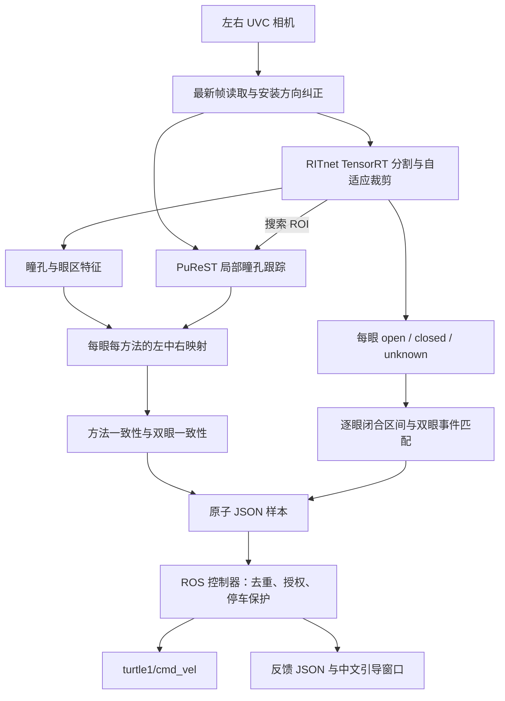
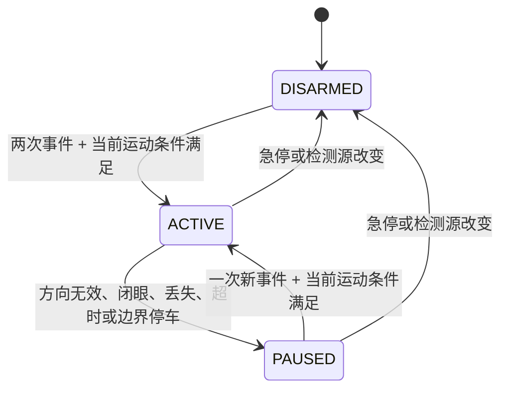

# 双摄像头眼动控制：算法与接口说明

更新日期：2026-10-16。本文依据当前代码编写，覆盖默认 `--fusion` 检测器与 turtlesim 控制器，包含右视裁剪跟踪修复。面向算法维护、ROS 接入和问题定位。

默认方案是 **RITnet + PuReST 二维方向融合、引导标定、逐眼眨眼事件匹配**。pye3d / Itoh 不参与当前默认链路；TEyeD 仅可选作日志对照。Gazebo 轮椅入口现已通过专用适配器接收同一融合样本，沿用双眨眼启动、视线直接转向、暂停后单眨眼恢复的输入逻辑，详见 [轮椅融合接口](../../../wheelchair_shared_ws/docs/EYE_FUSION_INTERFACE.md)。本文 turtlesim 验证结果不能直接推广到轮椅。

使用说明见 [当前操作总结](../CURRENT_EYE_CONTROL_SUMMARY.md)。本文描述的是实现行为，不代表已完成真实用户准确率评测。

## 1. 总体架构



方向与眨眼是两条证据链：方向暂时无效立即停止运动，但不会单独清掉已经确认且仍在时间窗口内的第一次眨眼。启动或恢复时，必须同时满足当前睁眼、方向有效和输入新鲜。

## 2. 硬件、坐标与时间

| 项目 | 当前约定 |
|---|---|
| 平台 | Jetson Orin，ROS 2 Humble，Python + TensorRT + OpenCV |
| 相机请求 | HBVCAM-1914S V44，640×480、30 FPS、MJPG |
| 左眼 | USB 路径尾部 `4.4.1:1.0-video-index0`，旋转 180° |
| 右眼 | USB 路径尾部 `4.4.2:1.0-video-index0`，旋转 0° |
| 图像坐标 | 安装方向纠正后的完整图像坐标；左上角为原点 |
| 瞳孔特征 | `x / image_width`，不是视线角度 |
| 方向输出 | `[-1,1]`，负数向左、正数向右 |
| 帧时间 | 摄像头线程完成读取的 `time.monotonic()`；不是硬件曝光时间 |
| 双眼帧对 | 读取完成时间差小于 80 ms |
| 新鲜度 | 处理结束时最旧帧龄小于 250 ms |

`LatestCamera` 后台持续读取，仅保留最新帧；主循环要求每个相机都有新的序号。请求 30 FPS 不等于双眼算法链路运行在 30 FPS。相机没有硬件同步。

## 3. 图像检测与裁剪跟踪

### 3.1 RITnet 分割

实现：[ritnet_backend.py](../tools/ritnet_backend.py)、[ritnet_blink.py](../tools/ritnet_blink.py)。

使用三个 TensorRT 引擎：`ritnet_640x480.engine`、`ritnet_320x240.engine`、`ritnet_320x240_b2.engine`。全图定位后，通常在每眼 320×240 原始尺度局部区域推理；双眼都有 ROI 时使用批量局部推理。

分割标签为背景 0、巩膜 1、虹膜 2、瞳孔 3。瞳孔后处理包括：

- 置信度大于 0.65 的瞳孔连通域；排除贴边、过小或过大组件。
- 面积范围 8 像素至标签图面积的 8%；边缘留白至少 `max(2, int(min(shape)*0.025))`。
- 瞳孔周围膨胀环中虹膜占比至少 0.35，拟合椭圆轴比至少 0.25。
- 两个大候选面积接近时拒绝，避免任意选择暗区。
- 可靠睁眼还要求瞳孔平均置信度至少 0.85，眼区面积大于标签图的 1%。

`pupil_area=0` 表示没有通过筛选的瞳孔，不等价于原始标签中完全没有瞳孔像素。

### 3.2 右视时的动态 ROI 修复

此前日志中左眼 ROI 从 x=256 开始，右视时瞳孔移到 x≈260，局部检测丢失；旧逻辑等未知持续 0.5 秒才重新定位，甚至将局部眼区消失判为闭眼。

当前处理：

1. 可靠瞳孔进入 ROI 边缘 30% 区域时，为下一帧重新居中窗口；窗口限制在图像内。
2. 局部没有可靠瞳孔时，在**同一张相机图像**上追加全图检测。
3. 全图找回瞳孔后，当前帧直接使用全图结果，下一帧用新的居中 ROI。
4. 全图也没有可靠瞳孔，但裁剪外高置信眼区超过完整图像面积的 1% 时，阻止局部 `closed` 输出，并取消旧 ROI 重新定位。
5. 全图检查没有上述外部眼区证据时，保留局部参考用于正常眨眼判断。ROI 改变时仍重置局部外观参考，不能跨裁剪复用闭眼证据。

诊断值 `crop_tracking.recovery`：`NONE`、`FULL_FRAME_PUPIL`、`FULL_FRAME_NO_PUPIL`、`EYE_OUTSIDE_CROP`。后两种情况仍依赖分割质量，不是对真实眼睑动作的直接测量。

### 3.3 睁闭眼判定

实现：`EyeState.update()`，位于 [ritnet_tracker.py](../tools/ritnet_tracker.py)。RITnet **没有专门的闭眼类别**，此处采用时序与外观启发式。

- `open`：检测到可靠瞳孔，更新参考眼区、外观和睁眼时间。
- `closed`：最近 1.5 秒内有睁眼参考；参考框内剩余眼区面积小于参考面积的 18%；分割平均置信度大于 0.85；局部灰度标准差大于 0.025；外围区域充足且外观稳定。
- `unknown`：证据不足或冲突。不再沿用旧的 open/closed 标签最多 80 ms。

融合入口使用缩放至 320×240 的**完整相机画面**检查外围稳定性，映射并排除局部眼区及边缘。外围比例须大于 20%，归一化灰度平均绝对变化须小于 0.09。面积参考做 `0.9×旧值 + 0.1×当前值` 更新。

外围不足记录 `INSUFFICIENT_SURROUNDINGS`；外观变化记录 `SURROUNDINGS_UNSTABLE`。局部眼区消失仍须经过裁剪外眼区保护。

### 3.4 PuReST 方向补充

实现：[purest_backend.py](../tools/purest_backend.py)、[C ABI](../tools/purest/bridge.cpp)。使用项目固定版本的原生 PuReST，不是阈值法替代实现。

- 只在已定位的眼区搜索；没有有效 ROI 时禁用跟踪。
- ROI 变化或相邻时间间隔不在 `(0,250 ms]` 时重置历史。
- 输出中心转回完整图像坐标；质量门限 0.6。
- RITnet 也有瞳孔时，两种中心欧氏距离超过图像宽度的 6% 则拒绝 PuReST。
- PuReST 可补充方向通道及综合眼状态，但不能否决 RITnet 的闭眼。
- **眨眼事件和最终运动所需的当前睁眼条件仍使用原始 RITnet 状态。** 综合 `eyes=open` 并不保证允许运动。

PuRe/PuReST 上游代码带非商业研究使用限制，来源及哈希见 `tools/purest/sources.json` 和 `third_party/PyPupilEXT/`。

## 4. 标定与方向融合

实现：[fusion_calibration.py](../tools/fusion_calibration.py)。

首次流程为正中→左→右→回正中确认。每步约 1 秒准备，之后至少 1.5 秒且至少 15 个稳定样本；每通道 P90−P10 不超过 0.025。闭眼、陈旧帧或无法提供每眼有效通道时重新积累。

参数文件 `state/fusion-calibration.json`：

| 字段 | 定义 |
|---|---|
| `schema` | `eye-fusion-v1` |
| `binding` | 相机标识、安装旋转、图像尺寸、模型/库签名、特征类型及质量门限 |
| `points` | 形状 `[3, eye_count, 2]`；第一维顺序是左、中、右，最后一维是 RITnet、PuReST |
| `selected` | 形状 `[eye_count, 2]`；参与融合的通道 |

采集顺序与文件存储顺序不同。每个选中通道必须左右分居中心两侧，最小分离至少 0.008，每眼至少一个有效通道。通过临时文件、fsync 和原子替换保存；保存失败不启用。配置绑定一致时只重新确认中心，中心相对原值偏移超过 0.06 时要求重新标定。

对某通道，设当前特征为 f，确认中心为 c，原标定左右相对中心偏移为 dL、dR：

- 若 `(f-c)×dR >= 0`，映射值为 `(f-c)/dR`；否则为 `(f-c)/(-dL)`。
- 同眼可用方法的映射差超过 0.5，返回 `DETECTORS_DISAGREE`。
- 同眼按质量加权，再截断至 `[-1,1]`；双眼差超过 0.65，返回 `EYES_DISAGREE`。
- 最终方向为各眼方向均值。单方法丢失可用另一已标定方法，双眼模式不会自动降级为单眼。

方法冲突检查在截断前进行，双眼检查在截断后进行。质量评分不是经过统计校准的正确概率。

## 5. 眨眼事件与控制状态

### 5.1 独立事件匹配

实现：[blink_events.py](../tools/blink_events.py)。每眼必须先明确睁眼，再明确闭眼，最后重新睁眼。

| 条件 | 当前值 |
|---|---|
| 每眼短闭合时长 | 60～400 ms |
| 两眼开始/结束错开 | 分别不超过 180 ms |
| 双眼闭合区间 | 必须重叠 |
| 未知状态桥接 | 最多 120 ms；未知本身不能建立事件 |
| 允许的相邻样本间隔 | `(0,250 ms]` |
| 长闭眼 | 两眼明确闭合持续约 650 ms，输出一次停止事件 |
| 源端短暂重发 | 事件结束后最多 180 ms |

短未知之后确认闭眼时，将闭合起点回溯到该段未知开始；因此持续时间是包括有限过渡的估计值。持续未知、陈旧输入或异常帧间隔取消证据。单眼眨眼不会匹配成双眼事件。

### 5.2 状态机



双眨眼完成时间窗口为 900 ms，融合启动器设置事件冷却 120 ms。授权最多等到事件结束后 250 ms；方向恢复本身不授权运动。短眨眼期间也会暂时停车，事件完成后可恢复。

跟踪丢失按样本采集时间设置事件屏障；事件开始必须不早于屏障。急停、边界停车、超时等本地停止按控制器当前时间设置屏障；旧样本不能降低既有屏障。修复了处理延迟把新眨眼误判为停止前事件的问题。

### 5.3 运动输出

控制循环 20 Hz。融合入口实际覆盖参数：

| 参数 | 融合入口值 | 控制器直接启动默认值 |
|---|---:|---:|
| `blink_input_mode` | `events` | `legacy` |
| `horizontal_deadzone` | 0.55 | 0.25 |
| `turn_release_threshold` | 0.25 | 0.15 |
| `blink_cooldown_ms` | 120 | 300 |
| `linear_speed` | 1.0 | 1.0 |
| `angular_speed` | 2.0 | 2.0 |
| `turn_pulse_duration_s` | 1.0 | 1.0 |
| `signal_timeout_ms` | 400 | 400 |

向左/右越过门限后产生约 1 秒转向脉冲，同时前进。方向回到中心释放区后才允许下一次触发；回中不会提前结束当前脉冲。输出 `Twist.linear.x` 为前进速度，左转 `angular.z` 为正，右转为负。停止时输出零速度。

turtlesim 边界保护默认范围 0～11、边缘距离 0.35，触边停止并调用传送服务回中心，冷却 2 秒。这是模拟器行为，不是真实车辆避障。

## 6. ROS 接口

默认环境 `ROS_DOMAIN_ID=58`、`ROS_LOCALHOST_ONLY=1`，由 `eye_ros_env.bash` 设置，可通过 `EYE_ROS_DOMAIN_ID`、`EYE_ROS_LOCALHOST_ONLY` 覆盖。

| Topic / Service | 类型 | 生产者 → 消费者 | 用途 |
|---|---|---|---|
| `/eye_tracking/fusion_samples` | `std_msgs/msg/String` | 融合检测器 → 控制器 | JSON 原子方向/眨眼样本 |
| `/eye_control/feedback` | `std_msgs/msg/String` | 控制器 → 检测器/UI | JSON 状态反馈 |
| `/eye_turtle/stop` | `std_msgs/msg/Bool` | 外部 → 控制器 | true 急停，false 不恢复 |
| `/turtle1/cmd_vel` | `geometry_msgs/msg/Twist` | 控制器 → turtlesim | 可由 `cmd_vel_topic` 改名 |
| `/turtle1/pose` | `turtlesim/msg/Pose` | turtlesim → 控制器 | 边界判断 |
| `/turtle1/teleport_absolute` | `turtlesim/srv/TeleportAbsolute` | 控制器调用 | 模拟器回中 |
| `/eye_tracking/signals` | `std_msgs/msg/Float32MultiArray` | 旧检测器 → legacy 控制器 | `[horizontal,closed,valid]`，不用于当前融合入口 |

融合样本发布/订阅深度均为 1；反馈发布深度 10，检测器订阅深度 1。使用 rclpy 默认可靠性/持久性配置。相机图像当前没有发布为 ROS Image topic。

### 6.1 融合样本 schema=1

以下为结构示例，时间必须替换为真实时钟值，不能原样重放控制：

```json
{
  "schema": 1,
  "session": "detector-session-uuid",
  "sequence": 42,
  "stamp_ns": 1792137782100000000,
  "source_t": 690580.0,
  "horizontal": 0.12,
  "motion_valid": true,
  "fresh": true,
  "calibrated": true,
  "open": true,
  "gesture_continuity": true,
  "long_close": false,
  "blink_event": {
    "id": 2,
    "start": 690579.84,
    "end": 690580.0,
    "durations": [0.16, 0.12]
  }
}
```

| 字段 | 语义与校验 |
|---|---|
| `session` | 非空源会话字符串，最长 128；检测器重启改变，控制器撤销会话授权 |
| `sequence` | 从 1 开始的递增整数；旧序号不刷新 watchdog |
| `stamp_ns` | 最旧帧采集时间映射到 ROS 时钟的纳秒时间，不是发送完成时间 |
| `source_t` | 同一帧在源单调时钟中的秒数；不可直接与 ROS 时间比较 |
| `horizontal` | 有限数，绝对值不超过 1 |
| `motion_valid` | 当前方向、睁眼、标定、新鲜度条件允许运动；本身不授予启动权限 |
| `fresh` / `calibrated` | 源端同步/帧龄检查及标定就绪状态 |
| `open` | 当前所有参与眼的原始 RITnet 状态均为 open |
| `gesture_continuity` | 当前眨眼时序证据连续；不是“当前有眨眼” |
| `long_close` | 一次长闭眼停止事件 |
| `blink_event` | 无事件为 null；完整事件或短暂重发的同一事件 |
| `blink_event.id` | 会话内递增正整数，用于事件去重 |
| `start` / `end` | 源单调时钟，所有眼最早开始/最晚结束 |
| `durations` | 按左、右顺序的各眼闭合秒数；单眼模式长度为 1 |

控制器还检查采集帧龄在 `[-50,250] ms` 内、事件持续范围、源端事件结束距当前样本不超过 250 ms。事件时间映射：`event_end_ros = stamp_ns/1e9 - (source_t-event.end)`，开始时间同理。

布尔字段要求 JSON boolean；不要发送 0/1 替代。JSON 不允许 NaN。格式错误触发 `INVALID_FUSION_SAMPLE` 并停车。

注意：函数内部有 `closed` 参数和日志字段，但 schema=1 的 ROS JSON **没有独立 closed 字段**；事件、`open` 和 `long_close` 承担相应语义。

### 6.2 控制器反馈

字段包括 `state`、`reason`、`resume_phase`、`resume_progress`、`blink_count`、`turn`、`turn_armed`、`horizontal`、`turn_threshold`、`last_blink_event_id`、`event_decision`。

- `state`：DISARMED / ACTIVE / PAUSED。
- `reason`：最近状态原因，可能滞后于当前输入，必须结合时间看。
- `blink_count`：未启用时当前窗口内的计数，最大 2；已启用时为 0。
- `event_decision`：NONE、ACCEPTED、REJECT_CONTINUITY、REJECT_BEFORE_STOP、REJECT_EVENT_AGE、REJECT_COOLDOWN、AUTHORIZATION_EXPIRED。为最近一次决策，并非每帧重新计算。
- `last_blink_event_id` 表示最近处理的事件 ID，不表示一定接受。
- `resume_phase/progress` 来自旧恢复辅助器，事件模式下不要据此推断事件匹配进度。

每个新的、通过基础样本校验的事件还输出 `BLINK_DECISION` 日志，包含 ID、决策、ROS 时间下起止、屏障、事件年龄及 `motion_ready`。不重复输出重发事件的决定。

## 7. Python 与 C++ 内部接口

| 接口 | 输入 | 输出/职责 |
|---|---|---|
| `LatestCamera.latest` | UVC 连续采集 | `(sequence, monotonic_stamp, BGR_frame)` |
| `AdaptiveRitnet.infer_views(frames)` | 左/右 BGR 图像列表 | 每眼 `(local, labels, confidence, ms, roi)`；同帧全图恢复 |
| `AdaptiveRitnet.feedback(eye,state,metrics,now)` | 完整坐标瞳孔及眼状态 | 更新下一帧 ROI、未知超时 |
| `RitnetBlink.infer(frames,stamps)` | 图像及读取时间 | `(states, details)`；眼数 1 或 2 |
| `PuReST.infer(frames,rois,stamps)` | 图像、ROI、时间 | 每眼 valid/center/confidence/error_code |
| `GuidedCalibration.observe(...)` | `[eye,method]` 特征与质量、状态、时间、新鲜度 | 更新引导、采集和保存状态 |
| `GuidedCalibration.horizontal(features,quality)` | 特征及质量 | `(horizontal, valid, eye_directions, reason)` |
| `BlinkEvents.update(states,now,permitted)` | 原始眼状态、单调秒数、允许标志 | `(event, long_close)`；另有 status/continuity |
| `FusionControl.update(...,gesture_states=...)` | 综合眼状态及原始 RITnet 状态 | 方向与兼容状态；发布时使用 motion_valid/open_eyes/outgoing_event |
| `EyeTurtleController.fusion_cb(msg)` | ROS String | 校验、去重、更新运动授权 |

`features`、`quality` 形状 `[eye_count,2]`，方法顺序固定为 RITnet、PuReST。内部缺失特征为 NaN，写日志时转换成 null。

PuReST 动态库为 `build/purest/libpurest.so`，C ABI：

```c
void* purest_create(void);
void purest_destroy(void* handle);
void purest_reset(void* handle);
int purest_process(void* handle, const unsigned char* gray,
                   int width, int height, double* out);
```

输入是连续 uint8 单通道图像，宽高至少 32。out 至少 7 个 double，顺序为局部 cx、cy、椭圆宽、高、角度、质量、valid。返回 0 表示调用正常，不代表检测有效；-1 为无效参数，-2 为异常并重置历史。每眼独立 handle，退出必须 destroy。

## 8. 启动与诊断

```bash
cd /home/whill/projects/EYETLE
# 完整融合 + 引导 + turtlesim，保存每次日志
./start_eye_turtle.sh --fusion 2>&1 | tee "model-results/fusion-live-$(date +%Y%m%d-%H%M%S).log"

# 仅检测与引导
./start_fusion.sh

# 仅双摄像头画面；左眼已纠正安装方向，Esc/Q 退出
.venv/bin/python tools/dual_eye_tracker.py --preview-both

# 无显示硬件诊断：不发布控制、不自动完成标定
./start_fusion.sh --no-display --max-frames 30 --report model-results/camera-check.json
```

预览和检测不要同时占用同一相机。程序更新后重启检测器和控制器；仅修改文件不会更新已运行进程。Ctrl+C 清理整套启动器子进程。

常用检测参数：`--eyes left|both`、`--left-camera`、`--right-camera`、`--left-rotation`、`--right-rotation`、`--calibration-file`、`--recalibrate`、`--teyed-reference`。后者增加推理开销，不参与投票。

标定 UI：C 重新确认中心，R 重新完整标定，Esc 退出；也可使用窗口按钮。

## 9. 日志定位方法

`FUSION_INPUT` 是状态变化加周期记录，不是每一帧；不能用行数计算识别率或直接重建全部时序。`eye_directions` 在过渡期间可能保留最近结果，不一定是当前有效方向。

| 现象 | 优先检查 |
|---|---|
| 向右看立即停止 | 左眼 pupil_center 相对 roi 的位置，crop_tracking 是否恢复、是否仍丢失 |
| 画面正常但 unknown | closure_diagnostics；区分没有有效瞳孔、眼区未塌缩、外围不足和外观变化 |
| 综合 eyes=open 仍暂停 | ritnet_states、motion_valid 对应日志 valid；PuReST 补充不等于原始睁眼 |
| 双眼 open 仍无效 | DETECTORS_DISAGREE / EYES_DISAGREE、各通道特征和标定 |
| 眨眼未形成事件 | 每眼 closed→open、时长/错开、blink_phase、gesture_continuity |
| 事件存在却未恢复 | BLINK_DECISION、controller_event_decision、当前 valid/open、事件年龄与屏障 |
| 恢复后立刻又停 | 找下一次无效样本，不能仅依据之前的 ACCEPTED 判断当前运动状态 |

已复现的两条现场日志：

- `fusion-live-20261016-155220.log`：外围参考不足、方向冲突及恢复事件过滤问题。
- `fusion-live-20261016-160252.log`：10 个完整事件均被接受，但右视时左眼裁剪丢失反复触发停车；这推动了同帧全图恢复修复。

## 10. 验证结果与限制

最新 101 项自动化测试通过，证据：[fusion-crop-tracking-tests.log](../model-results/fusion-crop-tracking-tests.log)。新增覆盖裁剪提前移动、图像边界限制、日志相同坐标的右视恢复、真实闭眼保留参考、裁剪外眼区禁止假闭眼、双眼批量分支独立恢复。

复现测试命令：

```bash
cd /home/whill/projects/EYETLE
source eye_ros_env.bash
export ROS_DOMAIN_ID=159
export PYTHONPATH="$PWD/src/eye_turtle_control:$PYTHONPATH"
.venv/bin/python -m unittest discover -s test
```

ROS 测试使用隔离 domain，避免与正在运行的控制系统共享话题。

最新 30 帧真实双摄像头诊断：[fusion-crop-tracking-camera.json](../model-results/fusion-crop-tracking-camera.json)。双眼处理耗时中位数约 81.2 ms、P95 208.5 ms；无显示模式按设计不就绪、有效控制帧为 0。该记录只证明采集与处理可运行，不是带动作标签的右视/眨眼效果验证。

仍需验证：不同用户及重新佩戴后的稳定性、真实右视检出率、眨眼误检漏检率、完整恢复后的持续控制。全图补检增加耗时，极端侧视、遮挡和分割错误仍可能停车。没有屏幕注视点精确估计、实测眼球三维模型或真实轮椅安全认证。

## 11. 维护入口

| 文件 | 责任 |
|---|---|
| `tools/fusion_tracker.py` | 相机、推理组织、发布、日志、UI 主循环 |
| `tools/ritnet_backend.py` | TensorRT、分割后处理、动态 ROI 与同帧恢复 |
| `tools/ritnet_blink.py` / `tools/ritnet_tracker.py` | 每眼外观参考、闭眼规则与裁剪保护 |
| `tools/purest_backend.py` / `tools/purest/` | 原生跟踪器及 ABI |
| `tools/fusion_calibration.py` | 标定、持久化、方向映射 |
| `tools/blink_events.py` | 逐眼眨眼配对 |
| `tools/fusion_control.py` | 方向和手势证据组织 |
| `tools/fusion_guide.py` | 中文引导与操作 |
| `src/eye_turtle_control/eye_turtle_control/controller.py` | ROS 协议、运动权限、停车与输出 |
| `start_eye_turtle.sh` / `eye_ros_env.bash` | 启动参数、ROS 环境、进程清理 |

历史方案与演变参见 [FUSION.md](../FUSION.md) 及 [历史归档](archive/EYE_CONTROL_PRE_FUSION_SUMMARY_2026-10-16.md)。历史测试数和耗时不代表当前版本。
