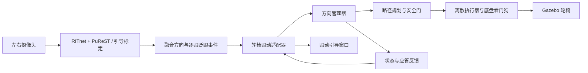

# 眼动控制轮椅：接口接入、交互调整与眨眼问题总结

整理日期：2026-10-19。本文总结本次会话中完成的工作；现场日志与测试结果来自 2026-10-16，不代表 10 月 19 日重新完成了真人驾驶验收。

## 1. 当前结果

10 月 19 日追加：根据无需看屏幕、眨眼后先看前方再看左右的操作习惯，融合适配器新增默认 0.5 秒的启动／恢复后视线缓冲（`post_blink_gaze_delay`）。缓冲内不提交左右转向，不缓存旧视线；缓冲结束后使用新采集样本。停车和避障仍即时生效。此调整用于过滤睁眼瞬间的转向，不表示墙角前进受阻循环已修复，缓冲时长还需真人佩戴验证。

EYETLE 当前的双摄像头 RITnet + PuReST 融合输出已接入轮椅仿真，替代键盘作为方向输入。最终采用小乌龟的输入操作方式：**双眨眼启动，运行中看左右直接提交转向意图，暂停后单眨眼恢复。** 不再要求每次改变方向都眨眼确认。

轮椅继续使用原有方向管理、路径规划、安全门、离散执行器和底盘看门狗。眼动适配器只提交意图，不直接发布底盘速度。

本次还根据现场日志修复了眨眼事件被错误停车时间屏障拒绝、正常闭眼同时被报为健康故障，以及旧导航状态撤销新恢复事务的问题。检测算法本身的真人漏检率尚未完成评测。

## 2. 为什么需要重新接接口

接入前，两个项目的默认链路已经不同：

| 项目 | 原接口与问题 | 本次处理 |
|---|---|---|
| 当前 EYETLE | `/eye_tracking/fusion_samples`，JSON 原子样本，含方向、有效性和完整眨眼事件 | 直接接收当前融合协议 |
| 原轮椅启动器 | 调用旧 `start_ritnet.sh`，使用 `EyeSample` 单目接口 | 默认改为 `start_fusion.sh --publish-ros` |
| ROS 环境 | 眼动与轮椅默认 domain 不同 | 启动器统一为轮椅 domain，默认 64 |
| 时间 | 眼动为系统／单调时间，轮椅任务使用仿真 `/clock` | 分开计算源帧龄、手势时间和方向事件时间 |

旧单目链路仍可显式通过 `--ritnet` 使用，本文描述的是默认融合链路。

## 3. 最终控制链路



方向识别、眨眼识别、运动授权、规划可行性是不同环节。界面显示“左／右”不等于轮椅已经收到运动授权；事件被接受也不保证当前环境允许完成转弯。

## 4. 当前操作规则

| 操作或条件 | 当前行为 |
|---|---|
| 完成标定后双眨眼 | 首次启动前进；两个完整事件结束间隔 120～900 ms |
| 运行中看左／右 | 超过方向阈值后直接提交左／右方向意图，无需眨眼确认 |
| 持续看同一侧 | 不连续重复提交 |
| 回到中心释放区 | 允许下一次侧向触发；不会取消已经提交的导航任务 |
| 短闭眼、方向无效或丢眼 | 立即暂停 |
| 已启动后，暂停时短眨眼一次 | 当前睁眼、方向有效且输入新鲜时恢复前进 |
| 仅恢复有效视线 | 不自动恢复运动 |
| 长闭眼 | 停车并清除待用手势授权 |
| 急停或检测器换会话 | 撤销启动授权，需要重新双眨眼 |

关键参数：侧向触发阈值为绝对值大于 0.55，回中释放阈值为绝对值小于 0.25；输入端转向脉冲门控为 1 秒。回中不提前结束当前输入脉冲。

**与小乌龟的区别在物理执行层：** 小乌龟能以连续 Twist 边前进边转弯；轮椅输入脉冲只提交一次方向偏好，实际转弯轨迹、时长和速度由规划与安全检查决定。不能把 1 秒输入脉冲理解为轮椅必定原地转 1 秒。当前未新增眼动掉头手势。

### 本次交互调整过程

最初沿用了轮椅的“看方向、双眨眼确认”，之后按使用反馈短暂调整为单眨眼确认。现场使用表明，这两种方式都不符合行驶中随时准备转向的需求，最终替换为上述小乌龟输入逻辑。历史文档中的“每次转向都要眨眼”不再适用于当前默认融合入口。

## 5. ROS 接口与时间约定

| 话题 | 类型 | 职责 |
|---|---|---|
| `/eye_tracking/fusion_samples` | `std_msgs/msg/String` | EYETLE 发布 schema=1 原子样本 |
| `/wheelchair/eye/direction_event` | `wheelchair_interfaces/msg/DirectionEvent` | 启动／恢复、左右偏好和 STOP |
| `/wheelchair/eye/health` | `wheelchair_interfaces/msg/InputHealth` | 输入跟踪健康与帧龄 |
| `/wheelchair/intent_ack` | `wheelchair_interfaces/msg/IntentAck` | 方向管理器接收／拒绝应答 |
| `/wheelchair/navigation_status` | `wheelchair_interfaces/msg/NavigationIntentStatus` | 导航阶段、任务与拒绝原因 |
| `/eye_control/feedback` | `std_msgs/msg/String` | DISARMED／ACTIVE／PAUSED、眨眼计数、原因及事件判定 |
| `/wheelchair/emergency_stop` | `std_msgs/msg/Empty` | 独立急停，同时撤销眼动启动授权 |

原始样本用同机系统时间计算采集年龄，再映射到本地单调时间；方向事件与导航消息使用 ROS 时间，仿真时为 `/clock`。两者不能直接混算。

会话、样本序号和眨眼事件 ID 均去重。重复样本不刷新健康，重发的同一眨眼不增加次数，旧会话不能重新取得授权。当前恢复授权最多保留到事件结束后 250 ms。

## 6. 两类现场问题及结论

### 6.1 界面显示转向，但轮椅一直直行

在 16:39:49 启动的运行中，导航日志出现的运动阶段为 `NAV_CRUISE`，没有进入左右转向阶段。用户确认当时只看左右，没有额外眨眼。

结合当时接口实现，原因是方向预览没有通过眨眼确认，因此没有生成转向事件。最终通过修改交互逻辑解决：现在运行中视线越过左右阈值即可提交方向意图。

### 6.2 眨眼后经常没有反应

分析了 16:56:17 启动的运行。按首次出现的眨眼 ID 去重：

| 日志结果 | 数量／现象 |
|---|---|
| 完整眨眼事件到达接口 | 21 个 |
| `ACCEPTED` | 10 个 |
| `REJECT_BEFORE_STOP` | 11 个 |
| 事件 17 恢复后 | 约 216 ms 后因 `INPUT_HEALTH_TIMEOUT` 再停 |
| 事件 19 恢复后 | 约 98 ms 后因相同原因再停 |

这说明不少“没识别”实际上是事件已经形成，却被接口拒绝，或者恢复后马上再次停车。上述数量不能用作检测准确率：这次缺少逐帧原始眼睛状态，也没有人工标注的真实眨眼总数。

另外，最初几个事件间隔超过 900 ms，不能组成双眨眼；事件 3、4 相隔约 400 ms，随后成功启动。

## 7. 眨眼可靠性修复

### 7.1 分开帧龄保护和手势到达超时

旧代码在旧帧采集年龄超过 250 ms 时，将停车屏障推进到当前接收时间。复现条件为每帧处理延迟约 180 ms、采样间隔 100～140 ms：新帧本身仍新鲜，但旧帧先超时，导致新眨眼起点落在被推进的屏障之前，被误拒绝。

修复后：

- 运动帧龄和健康上限仍为 250 ms，过旧仍停车。
- 仅因帧龄过旧停车时，保留有限手势历史，不直接把处理延迟认定为手势中断。
- 连续 400 ms 没有新有效接收才触发独立手势到达超时。
- 源端手势连续性、事件时间、当前睁眼及方向有效性仍需满足。
- 真正丢失、急停、长闭眼和会话改变仍清除相应授权。

该复现测试在旧实现失败、修复后通过；不能据此断言现场 11 次拒绝全部具有相同原因。

### 7.2 分开“输入健康”和“允许运动”

此前短闭眼既发 STOP，又因运动无效而上报输入设备健康无效，可能额外触发方向管理器的健康故障。

现在连续跟踪到的短闭眼仍立即暂停运动，但不同时视为设备故障。丢失、坏样本和帧超时仍上报健康无效。

### 7.3 防止旧导航状态清掉新恢复事务

管理器完成停车／启动交接前，可能仍发布上一任务的 STOPPED／BLOCKED。此前这些状态导致上下文变化，清除了新恢复指令。

融合接口现在等待 ACK 时保留当前事务，仍受 ACK 拒绝／超时、输入、时钟及管理器会话检查约束，底层安全检查继续执行。ACK 后的新 BLOCKED 仍会立即暂停。

本次没有放宽闭眼分割阈值、60～400 ms 短眨眼时长、双眼配对或 unknown 判定阈值。修改主要针对接口时序，不代表检测模型本身已完成鲁棒性优化。

## 8. 启动、日志和排查

10 月 19 日追加第一人称画面：下面的眼动启动命令默认打开乘坐者视角窗口，
相机高度约 1.2 m，随车移动与转向。按 F 全屏；Esc/Q 或关闭窗口会退出本次仿真。
设置 `WHEELCHAIR_GUI=false` 可只保留第一人称窗口，设置
`WHEELCHAIR_FIRST_PERSON=false` 可关闭该功能。详情见
[第一人称驾驶说明](../wheelchair_shared_ws/docs/WILLOW_OFFICE.md)。

先退出旧仿真以及占用相机的检测器，再运行：

```bash
cd ~/projects/EYETLE
WHEELCHAIR_SCENE=willow_office ./start_eye_wheelchair.sh
```

需要重新标定时追加 `--recalibrate`。默认 ROS domain 为 64、本机通信；通过 `WHEELCHAIR_ROS_DOMAIN_ID` 统一修改。Ctrl+C 关闭整套程序。源码修改后需重启检测器和控制器。

融合检测器启用 ROS 发布时，自动保存：

```text
~/projects/EYETLE/model-results/fusion-traces/日期时间-会话.jsonl
```

可通过 `EYE_FUSION_TRACE_DIR` 修改目录。日志逐样本、逐处理帧记录会话、序号、采集时间、帧龄、处理耗时、原始眼睛状态、分割诊断、手势起点／未知起点、完整事件与控制反馈。写盘失败会提示并关闭诊断日志，不改变控制逻辑。

轮椅适配器的 `EYE_DRIVE` 日志位于 `~/.ros/log/` 下对应节点日志，记录眨眼判定、事件起止、停车屏障及来源、样本年龄等。

排查顺序：

1. 检查原始逐眼状态是否经历可靠的睁眼→闭眼→睁眼。
2. 检查是否形成 `blink_event`；没有事件时看闭合时长、未知状态和双眼配对。
3. 有事件时检查接口 `event_decision`、屏障来源和事件年龄。
4. 事件接受后检查 ACK、导航阶段和随后停车原因。

## 9. 文件与维护入口

| 文件 | 本次职责 |
|---|---|
| [run_eye_sim.py](../wheelchair_shared_ws/scripts/run_eye_sim.py) | 统一启动、融合入口、ROS 环境与进程清理 |
| [fusion.py](../wheelchair_shared_ws/src/eye_shared_control/eye_shared_control/fusion.py) | 融合协议校验、启动／暂停／恢复、方向触发与手势保护 |
| [confirm_node.py](../wheelchair_shared_ws/src/eye_shared_control/eye_shared_control/confirm_node.py) | 事件传输、健康、ACK、导航状态和反馈日志 |
| [fusion_tracker.py](EYETLE/tools/fusion_tracker.py) | 检测发布、逐帧诊断与自动落盘 |
| [fusion_guide.py](EYETLE/tools/fusion_guide.py) | 轮椅操作提示与控制状态显示 |
| [test_fusion.py](../wheelchair_shared_ws/src/eye_shared_control/test/test_fusion.py) | 启动恢复、方向触发、协议、延迟与健康问题回归 |

## 10. 验证结果与未完成事项

最近一次相关修复后的记录：轮椅 Python 回归 **394 项通过**，EYETLE **101 项通过**，`eye_shared_control` 构建成功。包含真实 ROS JSON 到方向事件传输测试，以及 180 ms 处理延迟导致误拒绝的复现测试。

测试日志当时保存在 `/tmp/wheelchair-blink-robustness-tests.log`、`/tmp/eyetle-blink-robustness-tests.log` 和 `/tmp/wheelchair-blink-robustness-build.log`；临时目录文件不保证长期保留。此前 388、390、119 等测试数量对应不同阶段或子集，不能累加。

尚未完成：修复后真人佩戴驾驶验收、带动作标签的眨眼漏检／误检率评测，以及不同佩戴位置和不同用户的稳定性验证。若后续逐帧日志显示闭合阶段长期为 unknown，再结合图像与分割证据调整闭眼判定；若处理采样跨过整个短眨眼，则应优先优化推理耗时和采样频率。

## 11. 相关文档

- [当前轮椅融合接口](../wheelchair_shared_ws/docs/EYE_FUSION_INTERFACE.md)
- [眨眼现场诊断与修复](../wheelchair_shared_ws/docs/EYE_BLINK_DIAGNOSIS_20261016.md)
- [眼动架构与接口](EYETLE/docs/EYE_CONTROL_ARCHITECTURE_AND_INTERFACES.md)
- [轮椅项目与接口](WHEELCHAIR_PROJECT_SUMMARY_AND_INTERFACES.md)
