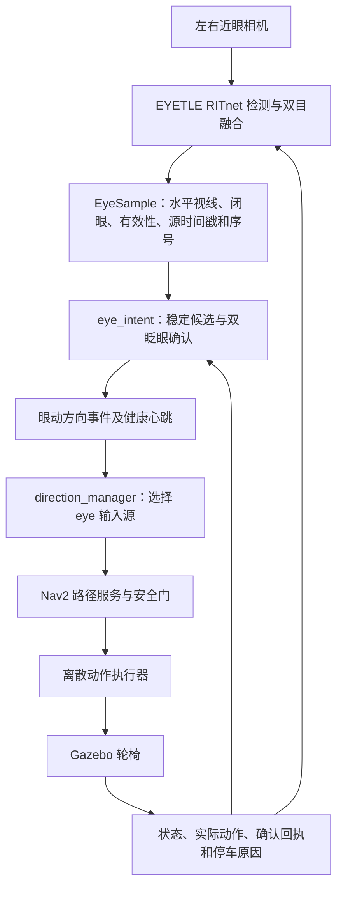

# 双目眼动接入轮椅导航与避障：工作总结

> 历史记录：用户随后改为使用最新版单目眼动，并要求不修改 EYETLE。当前接入以 [单目接口更新](WHEELCHAIR_MONOCULAR_EYE_INTERFACE_UPDATE.md) 为准，下文保留当时的双目实现与测试证据。

日期：2026-10-14  
检测项目：`/home/whill/projects/EYETLE`  
导航项目：`/home/whill/wheelchair_shared_ws`

## 1. 当前结论

已将 EYETLE 眼动检测作为方向键盘之外的一个输入接口，接入当前的方向管理、Nav2 路径规划、安全检查和 Gazebo 执行链路。按用户要求，组合入口现在**默认复用原有 RITnet 双目接口**，加载左右相机及已有的两份标定。

目前完成了代码接入、构建、自动测试、合成眼动驱动的办公室仿真，以及双摄像头独立采集短测。**尚未完成真实佩戴双目眼动驱动车辆的完整现场验收。** 双目复测中左眼持续为 UNKNOWN，需要佩戴后检查眼部画面和识别状态，不能把“相机打开、标定加载成功”当作眼动控制已可稳定使用。

本轮没有改变门洞安全距离限制，没有绕过碰撞检查，也没有接入真实轮椅底盘。

## 2. 接入关系



核心话题：

| 环节 | 话题 | 用途 |
|---|---|---|
| 原始检测 | `/eye_tracking/samples` | 带系统时间、源会话和递增序号的 `EyeSample` |
| 候选预览 | `/wheelchair/eye/candidate` | 展示稳定候选，不直接授权运动 |
| 方向事件 | `/wheelchair/eye/direction_event` | 与 W/A/D/STOP 对应的一次性事件 |
| 输入健康 | `/wheelchair/eye/health` | 检测时效和有效性 |
| 导航状态 | `/wheelchair/navigation_status` | 阶段、任务、目标及原因 |
| 确认回执 | `/wheelchair/intent_ack` | 接受或拒绝事件 |
| 检测窗口反馈 | `/eye_control/feedback` | 候选、ACK、导航状态和实际动作 |
| 安全输出 | `/wheelchair/action_safe` | 安全检查后的离散动作 |

眼动节点不发布 `/wheelchair/intent`、底盘速度或安全动作。它只产生输入事件，后续由公共导航链路处理。输入源在启动时选择，不能同时用键盘和眼动混合发布运动授权；键盘紧急停车仍可使用。

## 3. 当前交互方式

| 用户操作 | 结果 |
|---|---|
| 看正中稳定至少 250 ms，再双眨眼 | 对应 W，启动或继续直行 |
| 看左/右稳定至少 250 ms，再双眨眼 | 对应 A/D；停车时转约 20° 后保持停车，行驶时提交方向或入口偏好 |
| 长闭眼约 650 ms | 撤销当前任务并停车 |
| 丢眼、无效检测或输入超时 | 停车 |
| 恢复有效检测或重新睁眼 | 不自动恢复旧任务，需重新确认 |
| 普通扫视、单次短眨眼 | 不提交新的运动任务 |

必须等待窗口中的 **candidate 与目标方向一致，且 stable: YES** 再确认。Preview 表示即时视线，方向刚变化时可能与上一稳定候选不同。

`ACK: ACCEPTED` 只表示输入授权被接受，实际运动看 action、导航阶段和仿真。确认左/右不保证一定能够进入房间；门洞、旋转空间、车体轮廓和安全余量仍可能使任务被拒绝。

现有检测数据只有水平视线、闭眼和有效性，本轮**没有定义眼动掉头 U 手势**。键盘模式的 U 功能保留，不把连续眨眼或单眼动作猜测为掉头。

## 4. 双目接口与标定

复用的是原有 **RITnet `--eyes both` 路径**，包含双摄采集、模型推理、双目状态融合及标定加载，没有重写检测算法。项目中的旧 `start_dual_eye.sh` 是阈值/模板检测入口，不需要与本轮组合入口同时启动。

| 项目 | 当前配置 |
|---|---|
| 左相机 | `/dev/v4l/by-path/platform-3610000.usb-usb-0:4.4.1:1.0-video-index0` |
| 右相机 | `/dev/v4l/by-path/platform-3610000.usb-usb-0:4.4.2:1.0-video-index0` |
| 左画面旋转 | 180° |
| 右画面旋转 | 0° |
| 标定文件 | `projects/EYETLE/state/ritnet-calibration.json` |
| 已加载标定 | 左右两份，分别绑定相机、旋转方向、分辨率与模型 |

组合入口没有显式 `--eyes` 参数时自动加入 `--eyes both`；显式 `--eyes left` 仍可用于单眼排查。没有覆盖或重做用户已有标定。

## 5. 启动与退出

先关闭同 domain 的旧轮椅仿真及其他眼动检测器，再在图形桌面终端运行：

```bash
cd ~/projects/EYETLE
./start_eye_wheelchair.sh
```

上述命令默认启动双目检测和原办公室仿真。需要明确覆盖旧终端中的模式变量时：

```bash
WHEELCHAIR_INTERACTION_MODE=directional_intent ./start_eye_wheelchair.sh --eyes both
```

默认设置：

| 设置 | 值 |
|---|---|
| `interaction_mode` | `directional_intent` |
| `input_source` | `eye` |
| `eye_sample_mode` | `stamped` |
| `mode` | `corridor_assist` |
| 场景 | `clearpath_office` |
| ROS domain | 64；使用 `WHEELCHAIR_ROS_DOMAIN_ID` 修改 |

组合脚本统一检测和导航的 ROS domain，旧 EYETLE 环境中的 domain 58 不会覆盖轮椅默认 domain 64。带时间戳的原始样本使用系统时间；导航事件使用 ROS 仿真时间，两者分别校验。

可选终端：

```bash
# 查看路径、轮廓和停车原因
~/wheelchair_shared_ws/scripts/navigation_rviz.sh

# 紧急停车：在该终端按空格或 S
~/wheelchair_shared_ws/scripts/keyboard.sh
```

RITnet 窗口 Esc 或启动终端 Ctrl+C 会关闭本次组合入口启动的检测和仿真。摄像头窗口里的 A/S/D 是标定采集键，不是驾驶键。需要重标定时先停止车辆，再按窗口提示操作。

## 6. 主要修改

| 文件 | 修改内容 |
|---|---|
| [confirm_node.py](../wheelchair_shared_ws/src/eye_shared_control/eye_shared_control/confirm_node.py) | 复用确认状态机，增加方向事件映射及导航状态反馈 |
| [node.py](../wheelchair_shared_ws/src/eye_shared_control/eye_shared_control/node.py) | 接受 `directional_intent` 眼动模式 |
| [shared.launch.py](../wheelchair_shared_ws/src/wheelchair_control/launch/shared.launch.py) | 允许方向导航使用 eye 输入源 |
| [eye.launch.py](../wheelchair_shared_ws/src/eye_shared_control/launch/eye.launch.py) | 暴露交互模式和样本模式参数 |
| [run_eye_sim.py](../wheelchair_shared_ws/scripts/run_eye_sim.py) | 默认方向导航、带时间戳输入、双目检测，并统一 ROS domain |
| [intent_feedback.py](EYETLE/tools/intent_feedback.py) | 显示 W/A/D 意图、导航阶段和实际动作 |
| [ritnet_tracker.py](EYETLE/tools/ritnet_tracker.py) | 预览窗口支持方向导航反馈；本轮未修改推理及双目融合算法 |
| [validate_eye_directional.py](../wheelchair_shared_ws/scripts/validate_eye_directional.py) | 新增合成眼动经过完整 ROS/Gazebo 链路的验收 |

保留了旧 `intent_confirm`、`gaze_joystick` 和原 turtlesim 入口。轮椅组合入口的默认值以本总结和当前脚本为准，旧文档中的默认单目或旧眼动模式说明不再代表当前入口。

## 7. 已完成的验证

### 自动测试与构建

- 完整代码回归：**355 passed，20.09 s**。
- 双目默认值修改后的组合入口专项：**3 passed**，覆盖默认双目、显式单目、`--eyes=both` 参数形式，以及输入源、时间戳模式和 domain 配置。
- `wheelchair_control`、`eye_shared_control` 构建成功。双目默认值位于直接运行的脚本，无需额外编译模型。

### 合成眼动 + 真实 ROS/Gazebo/Nav2

使用隔离 domain 93、独立 Gazebo partition、原 `clearpath_office` 场景。输入是合成 `EyeSample`，不是现场用户眼动。

| 用例 | 结果 | 最大控制计算耗时 | 碰撞 | 运行期计算超时 / ACTION_STALE |
|---|---|---:|---:|---:|
| 左右确认转向、正中启动、长闭眼停车、无效数据/断流停车、恢复不自动运行、未选中键盘运动输入被忽略 | PASS | 35.17 ms | 0 | 0 |
| 眼动确认直行，在办公室障碍前停车，持续有效注视不自动恢复 | PASS | 29.89 ms | 0 | 0 |

障碍用例最终停在约 `(2.462, 0.000)`。此项证明输入能经过公共避障链路触发停车，不代表所有门洞、路线或动态障碍场景均已通过。

### 双摄像头独立短测

首次双目启动加载了两份标定，但左相机发生 `Camera disconnected or read failed`，未处理到帧。重试后两路采集完成：

| 指标 | 重试结果 |
|---|---:|
| 处理帧对 | 90 |
| 已加载标定 | 2 |
| 双目处理帧率 | 约 11.53 FPS |
| 处理耗时 P95 | 约 129.36 ms |
| 读取完成至处理后帧年龄 P95 | 约 151.66 ms |
| 左眼状态 | 90 帧 UNKNOWN |
| 右眼状态 | 23 帧 OPEN、67 帧 UNKNOWN |

这个短测没有启动控制器（报告为 `NO_CONTROLLER`），没有执行驾驶。帧年龄不含曝光和 USB 传输延迟，也不是眼动到轮椅动作的端到端延迟。

**因此目前能确认双路采集和标定加载可用，不能确认本次采集条件下双眼识别有效。** 左相机首次读失败的根因尚未定位；重试成功不等于硬件问题已修复。

## 8. 下一步现场试用

1. 佩戴设备，确认两路画面分别清晰覆盖左右眼；先排查左眼持续 UNKNOWN。
2. 确认两眼 OPEN/CLOSED 与实际一致，左/中/右候选方向正确。需要时重新标定，不沿用明显失配的配置。
3. 在大厅停车状态先验证左、右确认转向及完成后保持停车。
4. 再确认正中启动，验证长闭眼、移开眼部或断开检测时能停车，恢复检测不恢复旧动作。
5. 最后观察眼动驱动下的障碍前停车和可通行路线效果，记录误触发、漏确认、帧率和实际响应延迟。

真实佩戴的误触发率、短眨眼漏检率、长时间双摄稳定性、同时运行检测与仿真时的性能，以及完整眼动避障体验，均尚待现场确认。

## 9. 证据与关联说明

- [眼动方向接口使用说明](../wheelchair_shared_ws/docs/EYE_DIRECTIONAL.md)
- [手势链路验收结果](../wheelchair_shared_ws/artifacts/eye-direction-20261014/verified/gestures/result.json)
- [障碍前停车验收结果](../wheelchair_shared_ws/artifacts/eye-direction-20261014/verified/obstacle/result.json)
- [完整测试日志](../wheelchair_shared_ws/artifacts/eye-direction-20261014/tests-final.log)
- [构建日志](../wheelchair_shared_ws/artifacts/eye-direction-20261014/build-final.log)
- [首次双目启动日志](../wheelchair_shared_ws/artifacts/eye-direction-20261014/binocular-camera.log)
- [双目复测报告](../wheelchair_shared_ws/artifacts/eye-direction-20261014/binocular-camera-retry.json)
- [大厅转向与掉头修复](WHEELCHAIR_HALL_TURN_FIX.md)
- [办公室路口停车修复](WHEELCHAIR_OFFICE_JUNCTION_STOP_FIX.md)
