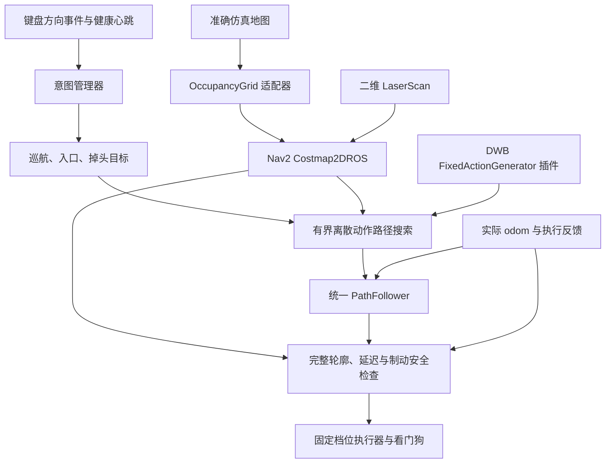

# Nav2 固定档位轮椅路径控制：当前实现与问题总结

日期：2026-10-14  
工作空间：`/home/whill/wheelchair_shared_ws`  
状态：**310 项 Python 回归与 30/30 专项 Gazebo 场景通过；后续现有办公室验证未通过，当前不能视为办公室可稳定使用。未做实机验收。**

## 路口停车的最新补充诊断

17:49 启动的办公室运行已实时确认膨胀半径为 **0.01 m**，但硬余量仍为 **0.06 m**。日志先出现 **52.30 ms 控制计算超时**，恢复后两次 **0 展开即无路**，随后停车期间又出现 `ACTION_STALE`。代码和日志重建发现走廊目标与横向约束轴不一致（目标偏差约 0.304 m，超过 0.25 m），需优先复现并修复。详见 [办公室路口停车诊断](WHEELCHAIR_OFFICE_JUNCTION_STOP_DIAGNOSIS.md)。本次仅整理诊断，未修改控制行为。

## 后续办公室验证（最新结论）

按用户要求，使用原 `clearpath_office` 办公室及默认参数验证，控制代码/配置与前次快照一致，模型未修改。5 类操作共 7 次试验：短程左右意图通过；前进停止恢复两次均计算超时（峰值约 56 ms）；较长左向路线未完成；掉头首次命令过期停车、复测通过。全部接触 0，Costmap 7 次正常退出，但**办公室整体尚未验收通过**。之前 30 项专项通过的结论仍只适用于对应测试范围。

详见 [办公室验证与眼动接入状态](../wheelchair_shared_ws/docs/NAV2_OFFICE_VALIDATION.md)。眼动架构可接，但新版方向意图适配尚未实现，不能直接切换 `input_source:=eye`。

> 后续办公室路口专项修复已完成代码与隔离仿真验证，结果和限制见 [办公室路口停车修复](WHEELCHAIR_OFFICE_JUNCTION_STOP_FIX.md)。上面的 17:49 记录为修复前证据。

## 2026-10-14 修复结果与最终验收

本节覆盖后文旧交接状态；后文“最新修改未运行”描述的是恢复修复之前的版本。

### 当前代码变更

- 保留搜索参数（250 ms / 启发式权重 4.0 / 开阔绕行余量 0.08 m）。原参数的恢复试跑已完成绕障，规划 48.40 ms / 255 节点，接触 0；但旧 Costmap 退出为 -11，此试次不是整体通过证据。
- `PathFollower` 删除转向同周期重复停车包络预测，仍由 `heading_tick` 做完整检查；最终直线段停稳后校正超出容差的朝向，再报告完成；直线跟踪按预计终点横向偏差判断是否需要补偿，避免对容差内残差反复停转。保留固定档位、完整制动/碰撞模型和 50 ms 保护。
- `NavigationScope` 删除上下文更新中的重复通道识别。规划服务增加 `allow_detour`：入口及其重规划禁止绕到其他入口；普通巡航允许通用绕障。被堵入口会拒绝并继续检查下一个候选。
- Costmap 崩溃：插件库保持加载至整个节点及其基类析构结束，防止订阅弱引用析构调用已卸载代码。清理前停止回调线程，并释放执行器与回调组。
- Costmap 卡住：实际线程栈证明 TF 接收线程与雷达消息过滤器发生锁反转。配置流程基于 Nav2 1.1.20 调整为 **TF、雷达及 TF 定时器共用同一个互斥回调组和专用执行线程**；地图更新仍独立运行。该改动在配置阶段即生效，不依靠退出时解除死锁。原始栈：`artifacts/nav2-entry-fixed/blocked_first/gazebo.log`。
- 退出阶段派发 `use_sim_time=false` 的异步参数事件，确认时钟切换后再回收线程。新增生命周期 shutdown 清理，以及缺失 TF 时可中断的激活等待。
- 验收脚本检查 Costmap 正常退出（主动 SIGKILL 用例除外），记录规划耗时/展开数；Gazebo 连续就绪 1 秒后才启动，运行时输入过期保护不变。

### 当前证据

- 构建通过；最近完整 Python 回归：**310 passed，18.99 s**。
- `scripts/validate_costmap_lifecycle.py`：重复配置/激活/停用/清理、冻结 `/clock` 后 SIGINT/SIGTERM、生命周期 shutdown、缺失 TF 激活时中断，四项退出码均为 0。结果：`artifacts/nav2-costmap-lifecycle/result.json`。
- 被堵首入口复测通过，选择第二入口，接触 0，安全计算峰值 37.80 ms，正常退出：`artifacts/nav2-serial-r2/blocked_first/result.json`。
- 第一轮完整回归 `artifacts/nav2-release-validation/` 为 27/30；29 次正常退出全部成功，主动 SIGKILL 用例按预期停车。三项失败为重复事件、转弯中 W、绕障的补偿耗时，修复后均在 `artifacts/nav2-tracking-fixed/` 通过。
- 绕障修复复测：规划 47.62 ms / 255 节点，安全计算峰值 26.43 ms，实际最小间距 0.230 m，接触 0，正常退出；动作切换 16 次（失败试次为 26 次）。
- **最终代码完整 30/30 场景通过**：[完整结果](../wheelchair_shared_ws/artifacts/nav2-final/result.json)。所有场景接触数为 0，安全计算峰值 **39.33 ms**，未放宽 50 ms 保护；29 次正常 Costmap 退出全部成功，另一次主动 SIGKILL（-9）验证保护停车成功。
- 最终绕障：规划 **55.30 ms / 255 节点**，安全计算峰值 **26.42 ms**，实际最小间距 **0.233 m**，完成绕障并继续前进，Costmap 正常退出。结果：[path_detour](../wheelchair_shared_ws/artifacts/nav2-final/path_detour/result.json)。
- [最终状态快照](../wheelchair_shared_ws/artifacts/nav2-final/status_snapshot.json)保存源码哈希、构建/测试状态及完整报告。此前目录均为中间版本或单项复测，不合并冒充一次完整通过。

### 复现最终验收

```bash
cd ~/wheelchair_shared_ws
source scripts/env.sh
colcon build --symlink-install --base-paths src
/usr/bin/python3 -m pytest tests src/eye_shared_control/test src/wheelchair_sim/test/test_scene_geometry.py -q
/usr/bin/python3 scripts/validate_costmap_lifecycle.py
/usr/bin/python3 scripts/validate_directional.py --case all --output artifacts/nav2-final
```

重跑会覆盖同名目录；如需保留证据，应使用新的 `--output` 目录。规划接口新增了 `allow_detour`，更新代码后须连同 `wheelchair_interfaces` 一起构建并重启相关节点。Costmap 配置包装针对当前 Nav2 1.1.20；后续升级 Nav2 时需核对该配置流程。

本轮完成的是仿真回归。眼动来源、三维点云、动态障碍预测、实机执行误差与用户体验验收仍不在本轮通过范围内。

配置实现参考：[Nav2 1.1.20 Costmap2DROS](https://github.com/ros-navigation/navigation2/blob/1.1.20/nav2_costmap_2d/src/costmap_2d_ros.cpp)。同类 TF 阻塞的上游报告：[geometry2 #995](https://github.com/ros2/geometry2/issues/995)。本项目修复使用本地线程栈作为诊断依据，未更新系统 ROS 库。

## 1. 原交接结论（修复前）

已把方向意图模式接入 Nav2 代价地图，新增固定动作轨迹生成插件、路径搜索服务和统一路径跟踪器，并加入 U 键掉头。

改造过程中的仿真已验证：提前选择左入口后转入、开阔区掉头后继续行驶、窄走廊拒绝不可执行的掉头。这些通过记录来自开发过程中的对应版本，**不能视作最后一次修改后的全部功能已通过**。

当前主要阻塞是**通用绕障尚不稳定**：出现过搜索超时；也出现过生成了路径、但跟踪到转向段时安全检查超过 50 ms，触发保护停车。最后一轮搜索逻辑和参数调整已经编译通过，尚未重新跑仿真。

这不是依赖安装没有完成，也不是固定速度原则上不能跟踪路径；问题在于目前的搜索效率、路径余量和实际离散动作执行之间还没有调到稳定状态。

## 2. 需求与底盘约束

用户确认的底盘能力：

- 前进与转向均为固定档位。
- 只能直行或原地旋转，不能一边前进一边转弯。
- 本轮动作集合仍为 STOP / FORWARD / LEFT / RIGHT，没有增加倒车或横移。
- 漫游与辅助应由系统自动衔接，不要求用户选择模式或逐次确认。

因此采用差速运动学、离散动作输入：路径由直行段和原地旋转段组成。掉头完成后朝相反方向执行 FORWARD，不是下发倒车指令。必要的停稳转向仍然存在，“无感”主要指无需人工切换模式，并保持已提交意图的连续性。

## 3. 实际采用的架构



### Nav2 的使用边界

实际复用了：

- `nav2_costmap_2d`：静态地图层、二维雷达障碍层和膨胀层。
- Nav2 的 footprint collision checker。
- `dwb_core::TrajectoryGenerator` 插件接口；新增 `FixedActionGenerator`，只生成真实支持的固定动作。
- `nav2_lifecycle_manager`：代价地图节点生命周期管理。

路径搜索是本项目新增的**有界加权 A***，使用上述 DWB 插件生成的运动基元；执行由 Python `PathFollower` 完成。

**本轮没有接入完整的 `controller_server + DWBLocalPlanner`，也没有接入 MPPI 或 Smac Planner。** 不能把当前实现描述为已经直接使用了完整的 Nav2 默认局部控制器。

## 4. 已落地的代码

| 文件或模块 | 当前职责 |
|---|---|
| `src/wheelchair_nav2/` | 新 C++ ROS 包，包含轨迹插件、路径搜索服务和独立 Costmap 包装节点 |
| `fixed_action_generator.cpp` | 固定直行/旋转/停止候选，显式建模加速、制动、启动与停稳时间 |
| `discrete_path_planner.cpp` | 基于 Nav2 地图检查完整轮廓，搜索位置和朝向路径；复用运动基元以减少重复计算 |
| `costmap_node.cpp` | 包装 Nav2 Costmap，处理独立运行时的生命周期与退出流程；退出稳定性仍需复查 |
| `wheelchair_control/path_tracking.py` | 通用路径解析和闭环执行；合并连续直线、同向旋转；拒绝需要弧线、横移或倒车的输入路径 |
| `wheelchair_control/navigation.py` | 保留方向意图、入口锁定、巡航目标与完成判定，把实际运动交给统一跟踪器 |
| `wheelchair_control/nav2_transport.py` | 仿真地图栅格化、异步路径请求、请求取消、规划器健康与地图新鲜度检查 |
| `ComputeDiscretePath.srv` | 带 task_id、request_id、起点、目标和路径范围的规划接口 |
| `DirectionEvent.msg`、`direction_manager.py`、`direction_input.py` | 新增 TURN_AROUND=6 和 U 键，复用去重、停止、替换与启动授权机制 |
| `planner.py`、`nodes.py`、`task_scope.py` | 接入新路径层与地图障碍，保留固定档位和最终安全检查 |
| `scripts/install_nav2_runtime.py` | 校验官方仓库签名、索引及包哈希，将所需 Nav2 子集安装到项目本地 |

Nav2 运行库位于 `vendor/nav2`，通过 `scripts/env.sh` 加载，不需要修改系统 ROS 安装。下载包及版本记录位于 `vendor/nav2/manifest.json`。ROS 环境为 Humble，当前安装的 Nav2 包为 1.1.20 系列。

## 5. 掉头、漫游与辅助行为

### 掉头

- 新增 U 键，提交一次 180°掉头事件。
- 停止状态仍需要先 W 启动；U 不绕过启动授权。
- 替换旧任务时先停稳，再规划和执行。
- 原地掉头路径会检查整个旋转过程；左向不可行时也检查右向。
- 跟踪器使用累计转角处理 ±180°边界，避免角度跳变导致转向反转。
- 同一事件重发、连续同键重复不重置任务；STOP 清空任务。
- 完成后建立新朝向巡航参考；新方向不能安全前进时停车。

开阔区掉头和狭窄空间拒绝已有通过记录；“左向受阻但右向可行”、重复 U、掉头中 STOP 等专门场景已加入脚本，但本轮尚未全部完成运行。

### 漫游与辅助

内部增加 ROAM / ASSIST 上下文，结合通路结构和当前障碍间距判断，配置了进入/退出滞回和稳定时间。用户不需要按键切换模式，也不需要确认状态变化。

两种上下文使用同一个路径跟踪器，不通过切换两套底盘控制器实现。开阔处沿锁定方向设置短程目标；通道中结合中心线和可通行范围生成目标；入口任务保留原入口身份。

**自动上下文逻辑已写入，但无感衔接的完整场景验收与主观连续性评价尚未完成。** 当前入口/通路解释仍主要基于正交直墙几何，不等于已经具备任意场景语义理解。

## 6. 验证现状

### 构建与 Python 测试

- 新接口、控制包及 `wheelchair_nav2` 包已成功构建。
- 最后一次 C++ 路径搜索修改后，`wheelchair_nav2` 构建通过，用时约 22.7 秒。
- 开发过程中一次完整 Python 单元/接口回归为 **308 passed，22.36 秒**，其中包含累计角度掉头、折线路径、直线合并、非法路径拒绝、地图栅格转换等测试。
- **308 项测试不是最后一轮 C++ 搜索调整的运行验证，也不能替代完整 Gazebo 验收。**

### 当前保存的 Nav2 仿真结果

| 场景 | 结果 | 观察 |
|---|---|---|
| `early_left` | PASS | 提前左侧意图后接近、转入并进入新方向巡航；接触 0 |
| `uturn_open` | PASS | 完成约 179.4°掉头并沿反向继续前进；接触 0 |
| `uturn_refused` | PASS | 窄走廊在旋转前拒绝不可执行掉头；接触 0 |
| `path_detour` | FAIL | 最新保存试次因路径搜索超时，没有开始运动；接触 0 不代表任务成功 |

结果位于 `wheelchair_shared_ws/artifacts/nav2-discrete/<case>/result.json`，每个目录还有 Gazebo 日志和逐周期 trace。同一场景重跑会覆盖该目录的旧试次。

本次交接额外保存了 [状态快照](../wheelchair_shared_ws/artifacts/nav2-discrete/status_snapshot.json)，其中包含当前报告、源码哈希、构建状态和“最新修改未做运行验证”的标记。

验收脚本现在包含 **30 个场景**，但新 Nav2 版本没有全量跑完。此前第一版方向意图模式的 **22 场景通过**保存在 `artifacts/directional/`，属于旧实现证据，不能算作新版本的全量通过。

## 7. 原交接未解决的问题（修复前）

### 7.1 通用绕障搜索超时

最新保存的 `path_detour` 试次展开约 1397 个节点、计算约 250.8 ms，触发 `PATH_SEARCH_TIMEOUT`。安全控制周期与路径搜索分属不同进程：前者仍是 50 ms 保护，后者当前搜索上限是 250 ms。

最后一次已编译但未运行验证的修改包括：

- 调整加权启发式系数为 4.0。
- 调整障碍代价权重为 1.0。
- 对需要绕行的开阔区搜索增加 0.08 m 跟踪余量；不是全局修改旧安全余量。

这些修改是否能稳定解决超时，**目前没有结果，不能宣称已修复**。

### 7.2 生成的路径仍可能难以稳定执行

较早一次绕障试跑已经生成路径并开始执行，但转向段出现多次短脉冲补偿，某周期安全检查耗时约 57.33 ms，超过原 50 ms 限制，触发停车。

分析认为，贴近障碍的名义路径、实际停车位置误差、栅格保守性及转向停车包络共同影响了可执行性。已经区分实际 odom 反馈年龄与地图年龄，并调整临近终点的脉冲候选检查顺序；碰撞预测仍保留地图年龄及制动检查。最终稳定性尚未验收。

停止保护本身起效，但绕障任务没有完成，因此不能把这个试次当成功。

### 7.3 Nav2 Costmap 退出异常

生命周期启动和 bond 接线已经修正，日志中能够进入 active 状态。但开发试次仍出现过退出超时、异常退出以及退出码 -11。最近修改了独立 Costmap 包装节点的清理流程，仍需单独验证退出、重启及失败恢复，不能宣称该问题已彻底解决。

### 7.4 尚缺完整回归

新版本还需要全量重跑入口、多入口、停止/取消、重复事件、进程中断、地图失效和旧模式兼容场景。当前不能将开发版本当成已经稳定验收的交付版本。

## 8. 当前关键参数

| 参数 | 当前值 | 说明 |
|---|---:|---|
| `path_lookahead` | 2.0 m | 巡航短程目标距离，可根据安全停车空间缩短 |
| `path_replan_distance` | 0.55 m | 剩余路径较短时提前请求续接 |
| `path_timeout` | 1.0 s | 异步路径请求超时 |
| `search_time_limit` | 0.25 s | C++ 单次搜索时间预算 |
| `max_search_expansions` | 12000 | 搜索节点上限 |
| `free_space_clearance` | 0.08 m | 最新开阔区绕行余量调整，未验证 |
| `heuristic_weight` | 4.0 | 最新加权搜索参数，未验证 |
| `obstacle_cost_weight` | 1.0 | 最新障碍代价参数，未验证 |
| `uturn_timeout` | 35 s | 掉头任务上限 |
| `maneuver_timeout` | 20 s | 入口任务上限 |
| `nav_position_tolerance` | 0.06 m | 路径位置容差 |
| `task_heading_tolerance` | 2° | 最终对正容差 |
| `nav_turn_envelope` | 10° | 目标角以外额外允许的有限预测范围；仍受碰撞检查约束，不是终点容差 |
| `context_assist_enter / leave` | 0.45 / 0.65 m | 上下文距离滞回 |
| `context_stable_time` | 0.5 s | 上下文稳定时间 |

参数主要在 `src/wheelchair_control/config/directional.yaml` 和 `src/wheelchair_nav2/config/nav2.yaml`。

## 9. 构建、运行与复现

以下为当前开发版本的复现方式，不表示相关场景均已通过。

```bash
cd ~/wheelchair_shared_ws
# 已安装本地 Nav2 运行库时不需要重复下载。
python3 scripts/install_nav2_runtime.py
source scripts/env.sh
colcon build --symlink-install --base-paths src
```

分别在不同终端运行：

```bash
~/wheelchair_shared_ws/scripts/run_direction_sim.sh scene:=intent_left
~/wheelchair_shared_ws/scripts/direction_keyboard.sh
~/wheelchair_shared_ws/scripts/direction_status.sh
```

W 启动/继续；A/D 左右偏好；U 掉头；C 取消偏好；空格/S 停止；X 退出。详细上下文可查看 `/wheelchair/task_trace`，最近规划路径为 `/wheelchair/local_plan`。

```bash
cd ~/wheelchair_shared_ws
source scripts/env.sh
/usr/bin/python3 -m pytest tests src/eye_shared_control/test src/wheelchair_sim/test/test_scene_geometry.py -q
/usr/bin/python3 scripts/validate_directional.py --case path_detour --output artifacts/nav2-discrete
/usr/bin/python3 scripts/validate_directional.py --case uturn_open --output artifacts/nav2-discrete
# 当前尚未完成的全量验证：
/usr/bin/python3 scripts/validate_directional.py --case all --output artifacts/nav2-discrete
```

## 10. 后续建议顺序

1. 先单独验证最新搜索修改，记录规划时间、展开节点、路径余量与实际通过情况，不同时调整更多模块。
2. 对一条固定绕障路径检查实际停车偏差及转向可执行性，减少不必要补偿；不通过删除制动模型或放宽 50 ms 保护获得“通过”。
3. 修复并验证 Costmap 正常退出、进程中断和重启。
4. 全量跑新旧回归，再确认漫游/辅助衔接的操作体验。
5. 最后接入眼动事件来源。

眼动适配、三维点云接入、移动障碍运动预测和实机验收均未在本轮完成。当前代码保留在工作空间，未回滚；改造前源码副本位于 `/tmp/wheelchair-path-following-backup`，这是临时备份，不是持久版本管理。
