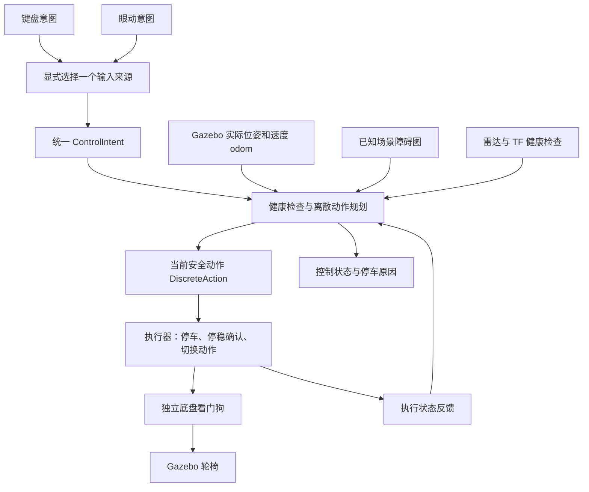

# 轮椅仿真避障逻辑概述

更新：2026-10-13。本文概括当前代码行为，不是待实现方案；不展开眼动识别逻辑。

## 1. 系统目前做什么

用户决定前进、左转、右转或停止。系统判断这个动作在当前速度、车体尺寸和障碍条件下是否安全，再决定放行、停车，或在允许的范围内辅助转向。

**当前是“已知仿真地图上的固定动作安全控制＋有限绕障”，不是依靠实时雷达建图的自主导航。** 不指定目的地、不规划全局路线、不自动倒车脱困、不通过降低速度放行危险动作。

## 2. 控制链路



键盘和眼动使用同一套规划器、避障检查、执行器和失效停车机制。输入端不直接给 Gazebo 发速度；切换输入来源需要重启选源配置，不会自动接管另一种输入。

## 3. 障碍信息和车体模型

| 数据 | 当前用途 |
|---|---|
| `/wheelchair/obstacle_map` | 碰撞判断的主要依据：障碍多边形和已知自由区域的外边界 |
| `/wheelchair/odom` | Gazebo 实际位姿及速度反馈，用于预测惯性、转向和制动 |
| `/wheelchair/scan` | 激光显示、格式与新鲜度检查；扫描点尚未转成控制器的障碍地图 |
| TF | 检查扫描坐标系到车体坐标系的变换是否可用 |
| `/wheelchair/executor_status` | 当前执行动作、是否停稳、执行器故障等 |

办公室障碍图由 Clearpath Office 模型离线生成：把离地 **0.04～1.30 米**范围内的几何投影到平面，以 5 厘米栅格保守扩张后合并成矩形。因此它包含部分雷达扫描平面看不到的家具结构，但也可能比可见空间更保守。

- 仿真实体外廓约 **长 1.00 × 宽 0.60 × 高 0.85 米**。
- 规划使用矩形轮廓：本体坐标 `x∈[-0.45,0.55]`、`y∈[-0.35,0.35]`，宽度比实体左右各多 5 厘米。
- 在此轮廓外，再计入 6 厘米基础间距、2.5 厘米模型误差，以及预测采样误差余量。它们不是一个固定的“雷达距离小于多少就停车”阈值。
- 雷达扫描高度约 **0.45 米**，车体回波尚未过滤。车体上的蓝点目前不会作为地图障碍触发碰撞判断。

**在 Gazebo 临时添加一个模型，不代表当前避障地图会自动认识它。** 动态测试场景预先占用障碍的整个运动走廊，也不是实时行人跟踪。

## 4. 每个控制周期怎样判断安全

规划周期配置为 **50 毫秒，即目标 20 Hz**，实际频率受运行负载影响。

1. **检查输入是否可信。** 意图、地图、雷达、odom、执行反馈必须有效且未过期；TF 必须可用。乱序、重放、会话改变、仿真时钟异常等会使旧授权失效。
2. **判断是否还处于停车锁定。** 锁定时保持 STOP；等禁用 STOP、停稳和恢复条件满足后，才允许用户重新确认。
3. **预测当前动作的全过程。** 从实际速度开始，包含观测延迟期间的运动、必要的先停车、启动延迟、动作持续时间、授权和通信延迟，以及最后的制动过程。
4. **沿轨迹检查完整车体。** 按最多 25 毫秒的步长采样车体多边形，检查距离、已知区域边界和辅助范围。脚踏前角旋转扫过的空间也会检查；不是只看车体中心。
5. **放行当前动作或发 STOP。** 下一周期重新计算，不把整条绕障序列提前排进执行队列。

碰撞或未知边界风险是硬约束，不能靠“更快到达”之类的评分抵消。如果连当前速度的制动轨迹都不安全，仍立即发 STOP，并报告 `STOPPING_ENVELOPE_RISK`；发出停车命令不等于轮椅瞬间静止。

几何计算缓存原始多边形，使用包围盒筛选和 Shapely/GEOS 精确距离运算。局部筛选用于减少计算量，没有缩小车体、删除安全余量或降低预测采样要求。

## 5. 控制模式

### `stop_only`：用户动作或停车

这是默认模式。

| 用户请求 | 安全时 | 不安全时 |
|---|---|---|
| FORWARD | 固定档位前进 | 停车 |
| LEFT | 固定档位左转 | 停车，不改为右转 |
| RIGHT | 固定档位右转 | 停车，不改为左转 |
| STOP | 立即撤销候选并发停车命令 | 同样停车 |

### `bounded_assist`：只为前进提供有限侧偏

直接前进安全时照常前进；不安全时，先确认能停下来，再检查两类候选：

```text
停车 → 左转 → 停车 → 前进
停车 → 右转 → 停车 → 前进
```

当前只搜索这种短序列，不搜索任意多段路线。候选必须满足碰撞、制动、空间范围和预测时长约束，并产生有用的前向进度；之后才按进度、间距、朝向偏离和切换代价评分。左右得分过于接近时，停车让用户选方向。

| 限制 | 当前默认值与含义 |
|---|---|
| 累计朝向偏离 | 相对本次前进参考朝向最多 15° |
| 累计横向偏移 | 相对参考方向最多 0.25 米 |
| 一次介入时间 | 最多 2 秒，从首次自动转向阶段开始，转后前进也计入 |
| 前置停稳等待 | 另有 2 秒超时 |
| 候选预测范围 | 初次制动之后的转向、停车和前进预测总时长不超过 3 秒 |
| 转向候选持续参数 | 0.30 秒；不等于实际总转向耗时，另有启动、延迟与制动 |

执行过程中保持选定侧，逐周期检查；用户 STOP、改方向或输入失效会取消候选。明确的 LEFT/RIGHT 请求仍按用户指定方向检查，不自动反向或前进。

**时间预算与空间预算分开处理：**

- 每次用户确认的运动授权最多启动一次自动侧偏。
- 辅助结束、超时或无安全动作后停车；持续 FORWARD 心跳不能自动解锁或刷新预算。
- 完成禁用 STOP 握手并接受新的用户授权后，重置本次辅助的时间和次数预算。这修复了“重新确认仍立刻命中旧计时”的问题。
- 重新确认不会重置累计角度和横移参考。同一输入会话内，用户明确转向后再请求前进，才建立新的前进参考。

所以它可以辅助轻微绕障，但不能保证自动对正并走完整条窄走廊。剩余空间额度不足、两侧都危险或无法决定绕哪侧时，仍需用户选择方向。

### `corridor_assist`：新直通道/门洞辅助

这是独立可选模式，自动使用 `narrow_control.yaml`，不替换前两种模式。新配置规划轮廓与0.60m宽仿真实体一致，保留原0.06m硬间距、0.025m模型误差和时间预算；0.15m舒适距离只作偏好。

在清晰的轴对齐直通道内提前对正、允许持续前进授权下多次有限微调；门洞进入前检查剩余完整穿越及停车路径，出口/分叉处停止等待选择。参考轴和中心稳定跟踪，地图变化撤销旧授权。转向时长从执行器RUNNING反馈计时；最坏授权失效包络仍属于硬检查。

新模式不是任意方向走廊识别或自动导航。参数、最终测试及限制见 [窄通道改进实现说明](WHEELCHAIR_NARROW_PASSAGE_IMPLEMENTATION.md)。

## 6. 执行器、有效期与停车恢复

执行器只输出以下固定指令；实际速度会受加速、制动和物理接触影响：

| 动作 | 线速度指令 | 角速度指令 |
|---|---:|---:|
| STOP | 0 | 0 |
| FORWARD | 0.372 m/s | 0 |
| LEFT | 0 | +0.389 rad/s |
| RIGHT | 0 | −0.403 rad/s |

方向切换采用“STOP → 根据实际 odom 确认停稳 → 启动新动作”。当前停稳条件是线速度绝对值小于 0.015 m/s、角速度绝对值小于 0.025 rad/s，并连续满足约 0.15 秒；切换后还有配置的启动延迟。长期未能停稳会报故障。重复收到同方向动作只续期，不反复启停。

| 检查项 | 当前时间限制 |
|---|---:|
| 用户意图有效期 | 250 ms |
| 当前安全动作有效期 | 150 ms |
| 雷达、障碍图允许年龄 | 250 ms |
| odom 允许年龄 | 150 ms |
| 执行状态有效期 | 250 ms |
| 底盘独立看门狗 | 200 ms 未收到执行器输出就发零速度 |

这些有效期由程序持续刷新，不要求用户按相同频率操作。接收方同时检查消息源时间和本机单调时间；源消息已经变旧，会减少剩余授权时间。不能单独把有效期调大而不重新核算停车距离。

障碍或故障停车后的恢复流程：

```text
保持 STOP → 输入端发禁用 STOP → 健康检查通过且停稳
→ 回报 ready_to_rearm → 用户重新确认 → 检查新的方向请求
```

键盘正常时 W/A/D 直接控制，空格或 S 停车，松开方向键不会停车。障碍/故障锁定后，停稳按 R，再按方向键；R 本身不恢复旧动作。重新确认只恢复请求资格，不保证新动作一定安全。

## 7. 怎样判断为什么停了

| 原因 | 含义 |
|---|---|
| `BLOCKED_FORWARD` / `BLOCKED_TURN` | 前进或转向的预测包络不安全 |
| `NO_USEFUL_SAFE_ASSIST` | 没有同时满足安全、进度和剩余辅助范围的候选 |
| `AMBIGUOUS_SIDE_CHOOSE_DIRECTION` | 两侧候选接近，需要用户选择 |
| `ASSIST_BOUND` | 达到累计角度或横移边界 |
| `ASSIST_TIME_LIMIT` / `ASSIST_ALREADY_USED` | 本次授权的辅助时间或次数用完 |
| `ACTION_STALE` | 执行器未及时收到有效动作 |
| `EXECUTOR_STALE` / `EXECUTOR_FAULT` | 执行反馈过期，或执行器自身报告故障 |
| `MAP_STALE_OR_INCOMPLETE` / `ODOM_STALE` | 地图或里程计不满足健康条件 |

空旷处停车不一定是障碍误检。此前已经复现过规划计算过慢导致动作过期，也观察过地图更新超时。几何计算已优化，但尚不能保证所有运行负载下都没有偶发超时。

查看状态：

```bash
~/wheelchair_shared_ws/scripts/status.sh
```

更详细的信息在 `/wheelchair/decision_trace`：意图、动作、停车原因、实际位姿与速度、辅助参考、候选结果、`compute_ms` 和 `executor_reason`。当前实现逐周期清空旧候选，并携带决策序号；仍应结合状态和原因判断，几何安全不等于时效检查也通过。

## 8. 当前验证和边界

- 已验证直行停车、转向扫掠、窄通道、有限侧偏、消息失效、节点退出和恢复不自动起步等仿真行为。
- 此前基础版本完整测试为 76 项通过；新增窄道版本的结果见实现说明。截图对应走廊位置复测中，用户明确右转对正后前进约 1.63 米，碰撞为 0；这不等于仅保持 FORWARD 即可自动通过整条走廊。
- 未完成：实时雷达/点云障碍地图、本体回波过滤、基于观测的未知/遮挡更新、实时动态障碍跟踪、落差检测。
- 当前限于平整无落差地面；地图高度带和车体模型针对当前简化仿真，不等于载人实机的完整保护体积。
- 实机轮廓、最坏制动和通信延迟、底盘持续动作及失联停车保障仍需单独实现和验证。

键盘验证命令（先关闭旧仿真）：

```bash
# 终端 1：办公室＋有限绕障
~/wheelchair_shared_ws/scripts/run_sim.sh \
  input_source:=keyboard mode:=bounded_assist scene:=clearpath_office

# 终端 2：键盘
~/wheelchair_shared_ws/scripts/keyboard.sh
```

把 `mode:=bounded_assist` 改成 `mode:=stop_only`，即可对照“只放行或停车”的基础模式。

## 9. 代码和记录入口

- [预测与辅助规划](../wheelchair_shared_ws/src/wheelchair_control/wheelchair_control/planner.py)
- [几何碰撞与距离计算](../wheelchair_shared_ws/src/wheelchair_control/wheelchair_control/geometry.py)
- [ROS 健康检查和控制链路](../wheelchair_shared_ws/src/wheelchair_control/wheelchair_control/nodes.py)
- [离散动作执行器](../wheelchair_shared_ws/src/wheelchair_control/wheelchair_control/executor.py)
- [当前控制参数](../wheelchair_shared_ws/src/wheelchair_control/config/control.yaml)
- [仿真障碍地图](../wheelchair_shared_ws/src/wheelchair_sim/wheelchair_sim/map_node.py)
- [测试记录](../wheelchair_shared_ws/TEST_RESULTS.md)
- [窄走廊复测结果](../wheelchair_shared_ws/artifacts/result-corridor.json)
