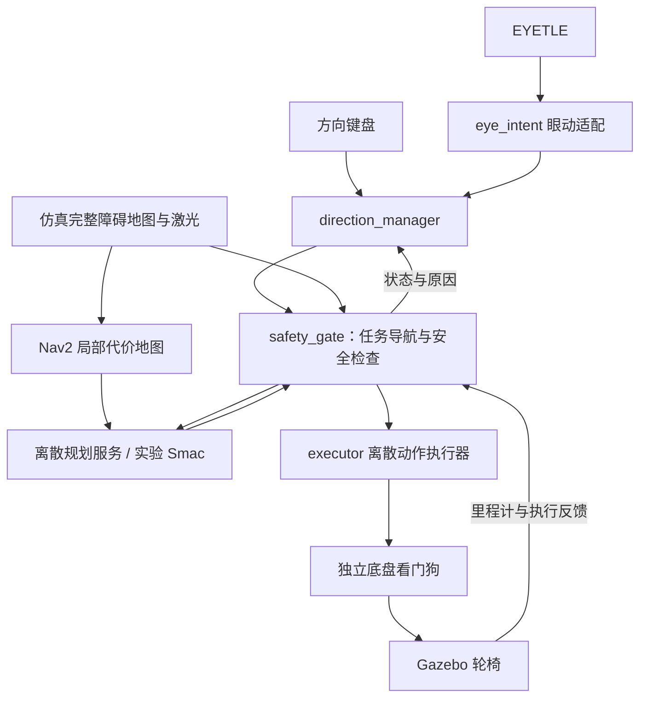

# 轮椅共享控制项目总结与接口说明

更新日期：2026-10-16。本文依据当前工作区代码和本轮验收记录整理，作为项目入口说明；历史阶段总结中的默认设置、测试数量不代表当前版本的统一验收结果。

算法简述见 [项目算法逻辑简述](WHEELCHAIR_ALGORITHM_OVERVIEW.md)。

## 1. 项目目标与当前范围

项目将键盘或眼动产生的“前进、偏向左侧、偏向右侧、停车”等意图，转换成轮椅可以执行的有限动作，并在规划与执行过程中持续检查障碍、车体占用范围和制动距离。

当前主链路是 **ROS 2 Humble + Gazebo Fortress + 方向意图管理 + Nav2 局部代价地图 + 自定义离散路径规划 + 安全门 + 离散执行器**。它是由用户指定方向、系统辅助通行的共享控制系统，尚不是面向任意远端目标点的全局自主导航系统。

当前实现范围：

- 键盘和 EYETLE 眼动共用后续导航、安全与执行链路，启动时选择一个运动输入源。
- 支持前进、原地左转、原地右转、停车；不下发倒车或连续弧线动作。
- 支持巡航、方向/入口偏好、停车转向、掉头、有限前移后转向。
- 默认采用原离散 C++ 规划器；Smac State Lattice 是可切换实验后端。
- 支持原 Clearpath 办公室与新 Willow Garage 办公楼。后者约 58.63 × 45.67 m。
- 依赖 Gazebo 提供的完整仿真障碍地图、仿真里程计和激光；没有完成实车底盘或真实环境感知验收。

## 2. 项目位置与模块职责

主工作区：`/home/whill/wheelchair_shared_ws`。眼动项目：`/home/whill/projects/EYETLE`。

| 模块 | 位置，相对于主工作区 | 职责 |
|---|---|---|
| 消息与服务 | `src/wheelchair_interfaces` | 输入事件、健康、控制任务、安全动作、状态及路径服务定义 |
| 方向管理与安全控制 | `src/wheelchair_control` | 事件管理、任务状态机、路径跟踪、碰撞/制动预测、执行器 |
| Nav2 接入 | `src/wheelchair_nav2` | 局部代价地图、默认离散规划服务、Smac 实验接口 |
| 仿真 | `src/wheelchair_sim` | 轮椅模型、场景、完整障碍地图、底盘看门狗 |
| 眼动适配 | `src/eye_shared_control` | 眼动样本到方向事件的转换、健康检查、交互反馈 |
| 可视化 | `src/wheelchair_scan_viz` | Gazebo 激光点显示 |
| 启动与验证 | `scripts` | 环境加载、键盘、状态、场景导入、自动验收 |
| 实验记录 | `artifacts` | 日志、轨迹、接触数、测试 JSON 与图像 |



## 3. 启动与操作

### 3.1 Willow 办公楼：当前推荐场景

分别在两个终端运行：

```bash
~/wheelchair_shared_ws/scripts/run_willow_sim.sh gui:=true
~/wheelchair_shared_ws/scripts/direction_keyboard.sh
```

仿真入口等价于：

```bash
~/wheelchair_shared_ws/scripts/run_direction_sim.sh scene:=willow_office gui:=true
```

地图首次加载需要数秒；同一 ROS domain 不要同时运行两套仿真。默认 domain 为 64，脚本使用本机通信。可通过 `WHEELCHAIR_ROS_DOMAIN_ID` 统一修改相关入口的 domain。

| 操作 | 当前方向模式行为 |
|---|---|
| W | 启动或继续沿当前方向巡航 |
| 行驶中 A / D | 提交左/右方向或入口偏好，由几何与规划决定可行行为 |
| 停车时 A / D | 转约 20°，完成后保持停车 |
| 行驶中 U | 掉头后继续巡航 |
| 停车时 U | 掉头约 180°，完成后保持停车 |
| C | 取消侧向偏好，经停车切换到当前方向巡航 |
| 空格 / S | 停车并撤销当前任务 |
| X / Ctrl+C | 键盘发出停车并退出 |

普通终端没有可靠 key-up；键盘通过静默间隔和事件幂等处理减少自动重复。输入进程退出或健康失效会停车。

### 3.2 其他入口

```bash
# 原办公室，默认离散规划器
~/wheelchair_shared_ws/scripts/run_direction_sim.sh scene:=clearpath_office gui:=true

# 实验 Smac 后端；并不意味着已经通过新办公楼完整验收
~/wheelchair_shared_ws/scripts/run_smac_sim.sh scene:=willow_office gui:=true

# 查看导航阶段、实际动作与拒绝原因
~/wheelchair_shared_ws/scripts/direction_status.sh

# RViz 查看路径、轮廓与诊断
~/wheelchair_shared_ws/scripts/navigation_rviz.sh
```

### 3.3 眼动输入

先退出现有仿真和重复检测器，再启动：

```bash
cd ~/projects/EYETLE
WHEELCHAIR_SCENE=willow_office ./start_eye_wheelchair.sh
```

轮椅入口默认调用 EYETLE `start_fusion.sh --publish-ros`，接收当前 RITnet + PuReST 融合 JSON 和已识别的眨眼事件，沿用检测器的引导标定。旧单目入口需显式添加 `--ritnet`。详见 [融合接口与操作](../wheelchair_shared_ws/docs/EYE_FUSION_INTERFACE.md)。尚未做真实眼动在 Willow 场景中的驾驶验收。

眼动交互沿用小乌龟：首次双眨眼启动，运行中看左／右直接提交方向意图，回中释放后才能再次触发。短闭眼、丢眼或无效数据立即暂停；已经启动后，用一次新短眨眼恢复。方向恢复不自动恢复运动。输入脉冲不等同于轮椅物理转向时长，实际动作由导航与避障决定。当前没有定义眼动 U 掉头手势。

## 4. ROS 接口

以下自定义类型均属于 `wheelchair_interfaces`，除非表中另有注明。方向输入只提交事件，不直接发布安全动作或底盘速度。

### 4.1 输入与交互反馈

| 话题 | 消息类型 | 生产者 → 消费者 / 用途 |
|---|---|---|
| `/wheelchair/keyboard/direction_event` | `msg/DirectionEvent` | 方向键盘 → 方向管理器 |
| `/wheelchair/keyboard/health` | `msg/InputHealth` | 键盘健康心跳 → 方向管理器 |
| `/eye_tracking/fusion_samples` | `std_msgs/msg/String` | 当前默认融合原子样本：方向、有效性、源时间、完整眨眼事件 |
| `/eye_tracking/samples` | `msg/EyeSample` | EYETLE → 眼动适配；水平视线、闭眼、有效性、源时间和序号 |
| `/wheelchair/eye/direction_event` | `msg/DirectionEvent` | 眼动适配 → 方向管理器 |
| `/wheelchair/eye/health` | `msg/InputHealth` | 眼动样本新鲜度与有效性 |
| `/wheelchair/eye/candidate` | `msg/CandidateStatus` | 稳定候选预览，不直接授权运动 |
| `/wheelchair/intent_ack` | `msg/IntentAck` | 管理器 → 输入端；事件接收/拒绝及原因 |
| `/wheelchair/navigation_status` | `msg/NavigationIntentStatus` | 阶段、偏好、目标、任务、实际动作及原因 |
| `/eye_control/feedback` | `std_msgs/msg/String` | 面向眼动窗口的交互反馈 |
| `/wheelchair/emergency_stop` | `std_msgs/msg/Empty` | 独立优先停车请求 |

`DirectionEvent` 的主要字段：`header`、`protocol_version=1`、`source_session_id`、`event_id`、`kind`、`ttl_ms`。

| `kind` | 含义 |
|---|---|
| 1 | `START_OR_CONTINUE` |
| 2 | `PREFER_LEFT` |
| 3 | `PREFER_RIGHT` |
| 4 | `CANCEL_PREFERENCE` |
| 5 | `STOP` |
| 6 | `TURN_AROUND` |

接入外部输入设备时，要发布所选输入源对应的事件和健康消息；会话、序号、时间戳与 TTL 均须符合协议。重发同一事件保留原 ID 和原时间，不通过重发延长授权。`ACK: ACCEPTED` 表示事件被接受，不保证路径可行或车辆已经移动。

眼动原始样本使用系统时间；方向事件使用 ROS 时间，仿真中为 `/clock`。两种时间不可直接混算。

### 4.2 内部控制与底盘链路

| 话题 | 类型 | 作用 |
|---|---|---|
| `/wheelchair/intent` | `msg/ControlIntent` | 方向管理器 → 安全门，包含任务和参考位姿 |
| `/wheelchair/action_safe` | `msg/DiscreteAction` | 安全门 → 执行器，经检查的离散动作与短 TTL |
| `/wheelchair/control_status` | `msg/ControlStatus` | 安全门状态、停车原因和重新授权就绪标志 |
| `/wheelchair/executor_status` | `msg/ExecutionStatus` | 实际动作、STOPPED/RUNNING/STOPPING/STARTING/FAULT |
| `/wheelchair/sim/drive` | `geometry_msgs/msg/Twist` | 执行器 → 独立底盘看门狗 |
| `/wheelchair/sim/cmd_vel` | `geometry_msgs/msg/Twist` | 看门狗 → Gazebo 桥接与底盘 |

动作编号：STOP=0、FORWARD=1、LEFT=2、RIGHT=3。`DiscreteAction.max_run_ms` 可限制一次连续运行时长，续租不能延长该次有界动作。

内部 `ControlIntent.task_kind`：3/4/5 为巡航/左偏好/右偏好，6 为行驶掉头，7/8/9 为停车左转/右转/掉头；1/2 保留给旧有限任务模式。`task_elapsed` 保存原任务经过时间，重规划不重置预算。

### 4.3 地图、传感器与诊断

| 话题 | 类型 | 作用 |
|---|---|---|
| `/wheelchair/odom` | `nav_msgs/msg/Odometry` | 仿真位姿和实际速度；父坐标系 `odom`，车体 `base_link` |
| `/wheelchair/scan` | `sensor_msgs/msg/LaserScan` | 激光观测，雷达坐标系 `base_scan` |
| `/wheelchair/obstacle_map` | `msg/ObstacleMap` | 仿真完整平面障碍多边形、已知边界与完整性标志 |
| `/wheelchair/planning_map` | `nav_msgs/msg/OccupancyGrid` | 完整障碍地图的栅格化结果 |
| `/wheelchair/local_costmap/costmap` | `nav_msgs/msg/OccupancyGrid` | Nav2 滚动局部代价地图 |
| `/wheelchair/local_plan` | `nav_msgs/msg/Path` | 客户端接受并发布的执行路径 |
| `/wheelchair/decision_trace` | `std_msgs/msg/String` | JSON 决策记录：预测、阶段、耗时、停止原因等 |
| `/wheelchair/safety_markers` | `visualization_msgs/msg/MarkerArray` | 安全检查可视化 |
| `/wheelchair/executor_timing` | `std_msgs/msg/String` | 执行时序诊断 |
| `/wheelchair/sim/contacts` | `ros_gz_interfaces/msg/Contacts` | 验收用物理接触记录 |

路径和地图主坐标系为 `odom`。完整地图来自仿真几何，不能描述成 SLAM 或仅凭激光重建出的真实环境地图。

### 4.4 路径规划服务

默认服务：`/wheelchair/compute_discrete_path`。
实验服务：`/wheelchair/smac/compute_discrete_path`。
两者类型均为 `wheelchair_interfaces/srv/ComputeDiscretePath`。

| 请求字段 | 含义 |
|---|---|
| `header` | 请求时间与坐标系，当前要求 `odom` |
| `task_id`、`request_id` | 关联任务与异步响应 |
| `start` | 起点 `geometry_msgs/Pose2D` |
| `goals` | 一个或多个目标位姿 |
| `max_path_length` | 路径长度上限 |
| `corridor_origin` | 走廊中心线参考位姿，独立于车体瞬时朝向 |
| `corridor_half_width` | 请求允许的中心线侧向范围 |
| `allow_detour` | 是否允许绕行；false 时保持指定直行/旋转路点组合 |

响应：`success`、`path`、`reason`、`expansions`、`compute_ms`、`costmap_stamp`，以及对应的任务/请求标识。

规划器只提供路径，不发布车轮命令。客户端校验响应身份、时效、坐标系和位姿合法性，再交给跟踪器；执行仍由安全门检查。

健康话题：默认 `/wheelchair/path_planner_health`，实验 `/wheelchair/smac/path_planner_health`，类型均为 `InputHealth`。Smac 另发布观察用 `/wheelchair/smac/raw_plan`，不能将其直接作为底盘指令。

## 5. 配置与行为边界

| 配置文件，相对于工作区 | 主要设置 |
|---|---|
| `src/wheelchair_control/config/narrow_control.yaml` | 车体、固定速度、制动能力、传感器时效和安全余量 |
| `src/wheelchair_control/config/directional.yaml` | 意图搜索、路径前视、转向任务、走廊出口策略 |
| `src/wheelchair_nav2/config/nav2.yaml` | 默认搜索预算、代价地图、激光层 |
| `src/wheelchair_nav2/config/smac_lattice.yaml` | 实验 Smac 搜索与基元配置 |

生产仿真轮廓为 x∈[-0.45, 0.55] m、y∈[-0.30, 0.30] m；前进速度 0.372 m/s，左右转角速度分别 0.389、0.403 rad/s。安全门周期 50 ms，动作 TTL 150 ms。完整配置仍以 YAML 为准，不以 Python 中未覆盖的缺省值代替。

当前 `nav_corridor_end_behavior: continue_straight` 允许沿当前走廊轴线驶出并直穿路口；车尾及余量完全离开后解除走廊约束，不自行选择左右分支。设为 `stop` 可恢复原停车确认策略。配置更改后重启仿真，安全配置不支持运行中在线调整。

## 6. 已验证内容与限制

| 项目 | 本轮或已有明确证据 |
|---|---|
| Willow 场景几何 | 6/6 场景几何测试通过，包含旧场景检查 |
| Willow 动态烟雾验收 | 巡航、停车、停车右转、恢复前进通过；6.57 m，物理接触 0，最小地图几何净距约 0.45 m |
| 走廊出口修改 | 修改时 Python 完整回归 302 项通过，后增现场坐标专项回归通过；原 Clearpath 出口完整动态复验仍未通过，曾因运行时健康超时提前停止 |
| Smac 实验后端 | 独立接口 11/11；已有 Gazebo 功能用例 6/7，实际 `path_obstacle` 绕障失败，不能作为默认后端替代验收 |
| 眼动 | 已有合成眼动到仿真的链路证据；真实佩戴下的稳定性和误触发率未完整验收 |

上述结果来自不同时间和范围，不能相加成一个“全部测试通过”数字。新办公楼的烟雾验收没有覆盖全部门洞、所有绕障路线、Smac 或真实眼动驾驶。

证据及进一步说明：

- [Willow 场景说明](../wheelchair_shared_ws/docs/WILLOW_OFFICE.md)
- [Willow 动态验收 JSON](../wheelchair_shared_ws/artifacts/willow-office-20261016/cruise_turn_resume/result.json)
- [眼动接口当前说明](../wheelchair_shared_ws/docs/EYE_DIRECTIONAL.md)
- [Smac 实验总结](WHEELCHAIR_SMAC_STATE_LATTICE_HUMBLE_SUMMARY.md)
- [位置调整说明](../wheelchair_shared_ws/docs/TURN_ADJUSTMENT.md)

旧文档中“眼动尚未接入”“默认双目”“所有走廊出口必须停车”等描述属于历史状态；当前接口以本文及源码为准。
