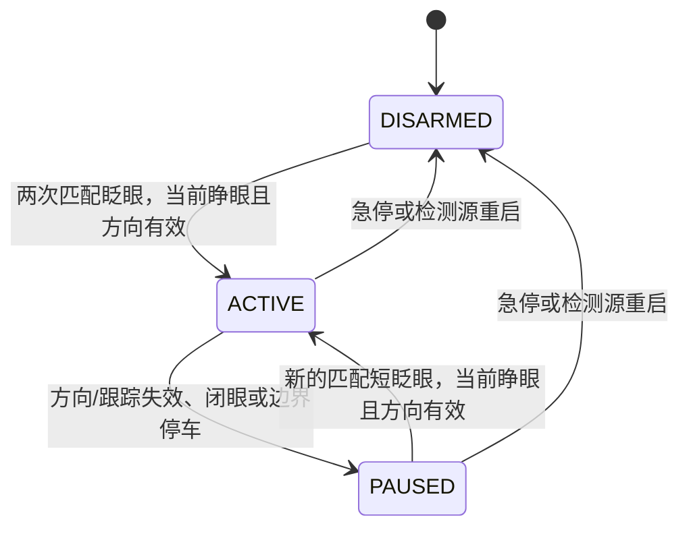

# 眼动检测与小乌龟控制总结

更新日期：2026-10-16。本文以当前融合入口的实现为准，说明使用方式、算法、状态转换、修复及验证范围。旧 RITnet/pye3d 说明已移至[历史归档](docs/archive/EYE_CONTROL_PRE_FUSION_SUMMARY_2026-10-16.md)，不要再按旧方案等待 `3D_READY` 或按 S。

完整算法、数据结构与 ROS/Python/C ABI 接口见 [技术总览](docs/EYE_CONTROL_ARCHITECTURE_AND_INTERFACES.md)。

## 1. 当前方案

默认方案是 **RITnet + PuReST 二维方向融合、居中可视化标定、左右眼独立眨眼事件匹配**。

- RITnet：定位眼区、分割瞳孔，并根据近期睁眼参考、眼区变化和周围图像稳定性判断睁闭眼。
- PuReST：在已定位的眼区内跟踪瞳孔，补充方向特征；不负责否决 RITnet 已确认的闭眼。
- 方向：先对每眼、每种方法分别做左/中/右映射，再检查一致性、融合结果。
- 眨眼：左右眼分别记录明确闭合、重新睁开的时间，匹配成完整事件，避免只计算两眼同时闭合的交集。
- 控制：方向有效性与眨眼事件分别判断。方向无效就停车；启动/恢复必须等当前双眼睁开、方向有效且输入新鲜。

当前不使用 pye3d/Itoh 在线眼球建模。TEyeD 可作为日志对照，不参与新融合方案的方向投票。

## 2. 启动与退出

### 检测、引导与小乌龟一起启动

```bash
cd /home/whill/projects/EYETLE
./start_eye_turtle.sh --fusion 2>&1 | tee model-results/fusion-live.log
```

不带参数运行 `./start_eye_turtle.sh` 也使用融合方案。上述命令会覆盖同名日志；要保留每次记录，可使用不同文件名。

### 只看检测和标定引导，不发布控制信号

```bash
cd /home/whill/projects/EYETLE
./start_fusion.sh
```

### 退出与更新后重启

- Ctrl+C：关闭整套启动器及其子进程。
- 引导窗口的“退出”按钮或 Esc：退出检测程序，整套启动器随后清理子进程。
- 本次修复同时改变了检测器和控制器的通信方式，必须关闭旧程序，再重启整套。只更新检测器、沿用旧控制器不能正常配合。

轮椅 `--gazebo` 入口尚未迁移到此方案；本文验证结论只针对检测器和小乌龟控制器。

## 3. 硬件与画面方向

| 项目 | 当前配置 |
|---|---|
| 平台 | Jetson Orin，ROS 2 Humble |
| 摄像头 | HBVCAM-1914S V44，按 640×480、30 FPS、MJPG 请求采集 |
| 左眼 | USB 路径末尾 `4.4.1:1.0-video-index0`，旋转 180° |
| 右眼 | USB 路径末尾 `4.4.2:1.0-video-index0`，旋转 0° |
| 默认眼数 | 双眼；可用 `--eyes left` 选择单眼 |

摄像头按 USB 路径匹配，避免 `/dev/videoN` 编号变化造成错配。请求 30 FPS 不等于整条算法链路能达到 30 FPS。当前检查的是软件读取完成时间，不是硬件同步曝光时间。

相机已固定，但重新佩戴、换用户仍可能改变眼睛相对相机的位置，保存参数能否复用仍需中心确认和现场验证。

## 4. 标定与可视化引导

首次使用：

```text
看正中 → 看左侧目标 → 看右侧目标 → 回正中确认 → 自动保存 → 等待双眨眼启动
```

- 窗口自动居中，标定时置顶；使用中文大字、亮色圆点、方向箭头、进度条和倒计时。
- 头部保持不动，只移动眼睛看目标；不需要逐步按键。
- 每步约 1 秒准备，随后连续稳定采集约 1.5 秒且至少 15 个样本。不清晰、闭眼或方向波动时会等待或重新积累，因此总时间不固定。
- 左、中、右区分不足时不会保存或启用控制。
- 成功后保存到 `state/fusion-calibration.json`，新参数成功写入前不覆盖原文件。
- 相机、旋转、图像尺寸和模型绑定一致时，下次只确认正中；中心不会在行驶中悄悄更新。

| 操作 | 作用 |
|---|---|
| “重新确认正中”或 C | 停车，重新确认当前佩戴位置的中心 |
| “重新标定左右”或 R | 停车，重新进行全部方向引导 |
| “重试保存” | 保存失败后重试；保存成功前不启用 |

不同用户可指定 `--calibration-file state/user-fusion.json`。切换单眼/双眼会改变配置绑定，建议使用不同参数文件。当前是简短自动引导标定，不是完全免标定。

## 5. 方向融合与转向阈值

```text
左右眼图像 → 安装方向纠正
                 ├─ RITnet → 眼区、瞳孔中心、睁闭眼
                 └─ PuReST → 眼区内的瞳孔中心与检测质量
                              ↓
               每眼/每种方法独立的方向映射
                              ↓
                 方法一致性 → 双眼一致性 → 方向输入
```

两个方法都使用完整图像坐标下的瞳孔横坐标。标定分别学习方向符号、中心偏移和左右响应幅度，避免直接比较相机安装不同造成的原始数值差异。

同一只眼的一种方法暂时丢失时，可使用另一种已经标定的方法；双眼模式不会在行驶中自动降级为单眼。没有可靠眼区时不让 PuReST 在整幅图像里任意寻找暗点。

当前关键参数：

| 参数 | 数值与含义 |
|---|---|
| 左转触发 | `horizontal < -0.55` |
| 右转触发 | `horizontal > +0.55` |
| 回中重新允许转向 | `abs(horizontal) < 0.25` |
| 单次转向 | 约 1 秒的转向脉冲，同时前进 |
| 同眼检测方法差异上限 | 标定后方向差 0.5 |
| 双眼方向差异上限 | 标定后方向差 0.65 |
| 帧对读取时间差 | 小于 80 ms |
| 处理后最旧帧龄 | 小于 250 ms |

方向范围是归一化的 [-1,1]，不是角度。转向门限已从 ±0.25 提高到 ±0.55，以减少小幅眼动触发。当前仍是脉冲转向：持续看左不会一直左转，回中也不会提前取消已经开始的脉冲。

## 6. 眨眼为什么曾经无法启动，以及当前修复

此前日志显示，中心确认后控制器仍长期为 `DISARMED`。主要原因：

1. PuReST 有时跟踪到眼睑上的暗区，把 RITnet 已确认的闭眼否决成未知。
2. 旧逻辑只计算两眼同时闭合的交集；交集约 50～54 ms 时，即使各眼闭合时间更长，也容易被 60 ms 门限过滤。
3. 眨眼开始时瞳孔消失、方向暂时无法计算，旧控制逻辑先清掉了眨眼历史。
4. 控制器反馈排队，使界面中的计数和状态显示滞后。

当前处理：

- 眨眼专门使用 RITnet 开闭状态；PuReST 的方向补充不作为眨眼依据。
- 每眼都要先明确睁眼，再观察到闭眼和重新睁眼。
- 每眼短眨眼持续时间为 60～400 ms；两眼开始和结束的错开均不超过 180 ms，闭合区间必须重叠。
- 未知状态最多桥接 120 ms，但不能仅凭 unknown 建立闭眼事件。短未知后确认 closed 时，起点回溯至未知过渡开始；持续丢失或帧间隔异常会取消证据。持续时间因此是含短过渡的估计值。
- 不再沿用最多 80 ms 的旧 open/closed 标签；当前证据不足就输出 unknown，由事件匹配器统一处理时序。
- 完整事件有独立 ID，短暂重发不会被重复计数。
- 方向暂时失效时先停车，但不单独取消已经确认的第一次眨眼；眨眼配对仍受 900 ms 窗口限制。
- 启动/恢复授权最多等待当前方向恢复 250 ms，过期即丢弃，不会在较长时间后突然启动。
- 界面反馈只保留最新一条，并显示“已识别一次眨眼，请再眨眼一次”。

右视裁剪跟踪修复（依据 `fusion-live-20261016-160252.log`）：

- 瞳孔进入裁剪边缘 30% 区域时提前重新居中，窗口限制在相机图像内。
- 裁剪内没有可靠瞳孔时，同一帧追加全图检测；找回瞳孔则立即使用全图坐标，并为下一帧重新居中，不再仅等待 0.5 秒未知超时。
- 全图仍找不到瞳孔时，若裁剪外存在显著眼区，禁止把局部消失判成闭眼，并重新定位；实际闭眼则保留原裁剪参考以完成眨眼事件。
- 日志 `ritnet[].crop_tracking` 记录 `FULL_FRAME_PUPIL`、`FULL_FRAME_NO_PUPIL`、`EYE_OUTSIDE_CROP` 及闭眼阻断状态。
- 全图补检会增加丢失帧处理耗时，250 ms 新鲜度限制仍保留。此修复不能保证所有极端侧视都有效，需真实佩戴复测。

本次进一步修复（依据 `fusion-live-20261016-155220.log`）：

- RITnet 在裁剪图中分割，但外围稳定性检查改用完整相机画面（缩放至 320×240），将眼区及边缘映射后排除；避免裁剪内外围占比不足 20% 导致无法判闭眼。裁剪变化仍重置参考。
- `INSUFFICIENT_SURROUNDINGS` 与 `SURROUNDINGS_UNSTABLE` 分开记录，不再混淆外围不足和图像变化。
- 控制器收到跟踪丢失样本时，以采集时间建立眨眼屏障，避免处理延迟拒绝采集时间更晚的新眨眼；急停、边界、超时等本地停止仍以控制器当前时间为屏障，旧样本不能降低屏障。
- 每个新事件输出 `BLINK_DECISION`，记录接受/拒绝原因、起止时间、屏障和事件年龄；反馈及融合日志增加 `controller_event_decision`。
- 双眼方向冲突和未知状态仍立即停止，不会因为此次修复放宽运动条件。

这修复的是事件时序和控制耦合问题。如果某只眼始终没有被识别为 closed，仍可能漏检，不能靠事件匹配凭空补出闭眼。

## 7. 控制状态转换



| 状态或动作 | 当前规则 |
|---|---|
| 首次启用 | 两次匹配事件完成时间在 900 ms 窗口内，并满足当前运动输入条件 |
| 暂停后仅睁眼、仅看正中 | 保持停止 |
| 暂停恢复 | 新的一次匹配短眨眼，且当前双眼睁开、方向有效、帧新鲜 |
| 闭眼过程中 | 方向不可用时先停车；合格短眨眼确认后可按恢复规则继续 |
| 长闭眼 | 双眼确认持续闭合约 650 ms，取消待用授权；不当作短眨眼 |
| 急停 | 撤销会话，必须重新完成双眨眼 |
| 超时、持续眼状态丢失 | 停车并取消待用事件/授权 |
| 重新启动检测器 | 新会话，需要重新双眨眼 |

因此短眨眼期间也可能出现短暂停车，完整事件确认且方向恢复后再继续。恢复的是行驶权限，如果当时看向侧方，可以立即触发转向；要恢复直行，应看正中完成眨眼。

## 8. 通信与日志

当前融合入口使用 `/eye_tracking/fusion_samples`，每条 JSON 原子样本包含：

- 会话 ID、消息序号、采集时间及新鲜度；
- 方向值、方向是否有效、是否重新睁眼；
- 独立眨眼事件、长闭眼及眼状态连续性。

控制器由启动器设置 `blink_input_mode:=events`，按会话、消息序号和事件 ID 去重。旧 `--teyed`、`--ritnet`、演示入口仍使用三元素 `/eye_tracking/signals`，两种协议不能混用。

主日志为 `model-results/fusion-live.log`，重点字段：

| 字段 | 含义 |
|---|---|
| `phase` / `progress` | 标定步骤和采集进度 |
| `ritnet_states` | 眨眼匹配实际使用的每眼状态 |
| `eyes` | 综合检测后的眼状态，可能含 PuReST 的睁眼补充 |
| `features` / `quality` | 每眼两种方向检测的原始特征与质量评分 |
| `ritnet[].closure_diagnostics` | 闭眼判定原因、外围像素比例/变化、眼区剩余面积比例 |
| `blink_event` | 新完成的眨眼事件，含 ID、开始/结束及每眼持续时间 |
| `blink_phase` | 匹配器正在观察、闭合、完成事件或跟踪丢失 |
| `gesture_continuity` | 眨眼证据链是否连续 |
| `valid` | 当前方向是否允许运动，不等于眨眼事件是否有效 |
| `controller_blinks` | 控制器当前双眨眼计数 |
| `controller` | DISARMED、ACTIVE 或 PAUSED |
| `controller_reason` | 最近控制状态原因，需结合当前输入和时间看 |

日志是状态变化加周期记录，并非所有帧。不能直接用日志条数计算准确率，也不能仅靠这些记录还原每一帧的真实眼睑动作。

## 9. 已验证与未验证

已验证：

- 最新 **101 项自动化测试通过**，包括原生 PuReST、标定保存/复用、方向映射、冲突拒绝、独立眨眼匹配与控制器状态转换。
- 回归测试验证：闭合交集只有 50 ms，但每眼自身闭合达标时，可以形成事件并通过双眨眼启用。
- 重复事件不重复计数；过期授权不会自动恢复；急停、长闭眼、持续丢失和消息超时仍停车。
- 隔离 ROS_DOMAIN_ID=159 的实际消息发布/订阅检查得到：两次事件、成功启用、无效输入后停止。未启动运动设备。
- 居中窗口在当前 2560×1440 屏幕上检查过位置、中文和布局。
- 之前 90 帧无显示硬件诊断的双眼处理耗时中位数约 74.0 ms、P95 118.6 ms。该数据早于独立事件通信更新，且不包含完整现场控制验证。

证据文件：

- `model-results/fusion-crop-tracking-tests.log`（最新 101 项）
- `model-results/fusion-crop-tracking-camera.json`（本次双摄像头采集诊断）
- `model-results/fusion-resume-fix-tests.log`（前次 96 项）
- `model-results/fusion-resume-camera.json`（双摄像头诊断，不发布运动）
- `model-results/fusion-blink-observation-tests.log`（前次 92 项）
- `model-results/fusion-blink-observation-analysis.md`（本次日志定位及验证边界）
- `model-results/fusion-event-tests.log`
- `model-results/fusion-event-transport.json`
- `model-results/fusion-camera-final.json`
- `model-results/fusion-guide-left.png`

尚未完成：

- 最新修复后，带真实动作标签的佩戴眨眼检出率与误检率测试。
- 不同用户、重新佩戴、长时间使用时的方向准确率与稳定性验证。
- 实测相机内参/畸变校正与真实轮椅验证。

自动化通过和程序跑通不等于真实识别准确，不能宣称已解决所有漏检和侧视误判。

## 10. 主要文件与对照方案

| 文件 | 作用 |
|---|---|
| `tools/fusion_tracker.py` | 双摄像头采集、融合调用、引导窗口与事件样本发布 |
| `tools/fusion_calibration.py` | 左/中/右采集、参数绑定、保存与方向映射 |
| `tools/fusion_guide.py` | 居中中文界面、箭头、目标点、倒计时与按钮 |
| `tools/fusion_control.py` | 方向融合状态与独立眨眼事件组织 |
| `tools/blink_events.py` | 左右眼完整眨眼事件匹配 |
| `tools/ritnet_blink.py` | RITnet 分割与睁闭眼适配 |
| `tools/purest_backend.py`、`tools/purest/` | PuReST 原生算法接口、构建与来源校验 |
| `src/eye_turtle_control/eye_turtle_control/controller.py` | 海龟运动、事件接收、启用/暂停/恢复与保护 |
| `start_eye_turtle.sh` | 整套启动和退出清理；默认融合方案 |

对照入口保留：`--teyed` 为 TEyeD + RITnet，`--ritnet` 为早期 RITnet/pye3d，`--itoh` 为暂停推荐的原 C++ 三维试验。它们不代表当前默认方案，不能混用其标定流程和日志解释。

详细资料：[融合实现](FUSION.md)、[算法筛选与融合建议](ALGORITHM_OPTIONS_2026-10-16.md)、[TEyeD 对照](TEYED.md)、[Itoh 试验记录](ITOH.md)。PuRe/PuReST 原代码带非商业研究使用限制，具体来源及许可见融合文档与 `third_party/PyPupilEXT/`。
