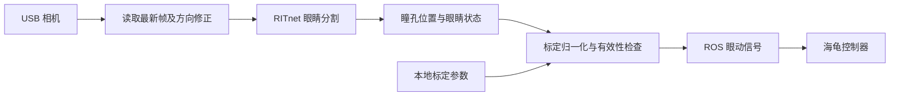

# EYETLE 眼动检测与控制部署总结

> **2026-10-14 更新：默认已切换三维眼球估计 + 一次正前方确认。** 启动、保存参考、移位处理及限制见 [GAZE3D.md](GAZE3D.md)。下文原三点标定对应 `--gaze-method legacy`。


更新日期：2026-10-13  
项目位置：`/home/whill/projects/EYETLE`

## 1. 当前完成情况

项目已接入眼镜上的两台近眼摄像头，部署官方 RITnet 预训练眼睛分割模型，通过 TensorRT FP16 在 Orin GPU 上推理，支持单眼和双眼运行。检测结果接入原有 ROS 2 海龟控制器，保留双眨眼前进、左右注视转向和长闭眼暂停及单次短眨眼恢复，已移除后退功能和正常行驶的 5 秒限时。

标定已改为**按键后开始采样、采够稳定样本后自动保存**。完成一次有效标定后，正常重启程序或电脑会自动加载参数，不再要求每次重新标定。

| 功能 | 当前状态 |
|---|---|
| 两路 USB 摄像头采集 | 已接入，支持单左眼或双眼运行 |
| 左眼图像倒置修正 | 默认旋转 180°；修正同时作用于显示和检测 |
| 眼睛检测 | RITnet 自动分割背景、眼白、虹膜、瞳孔，无需手工框选 |
| GPU 部署 | TensorRT FP16，全图定位、局部跟踪、双眼合批推理 |
| 水平注视方向 | 三点标定后输出左负右正的归一化位置 |
| 眨眼控制 | 已接入双眨眼前进、长闭眼停止；后退已删除 |
| 标定保存与复用 | 已实现自动保存、启动加载、部分步骤恢复和重标定 |
| 实际准确率量化 | 尚未完成带人工标注的验收 |

## 2. 硬件与运行环境

- 摄像头：两台 HBVCAM-1914S V44，GC0308 黑白传感器，USB UVC 接口。
- 当前采集配置：MJPG、640×480、请求 30 FPS。
- 计算设备：NVIDIA Jetson Orin，aarch64；性能测试时为 MAXN 模式。
- 系统软件：Jetson Linux R36.4.4、ROS 2 Humble、TensorRT 10.3。
- 运行环境：项目 `.venv`；模型导出使用独立的 `.venv-model`，日常推理不依赖 PyTorch。

当前安装对应关系：

| 佩戴侧 | USB 端口路径中的标识 | 接入时的图像节点 | 默认旋转 |
|---|---|---|---|
| 左眼 | `4.4.1` | `/dev/video2` | 180° |
| 右眼 | `4.4.2` | `/dev/video0` | 0° |

`/dev/videoN` 编号可能因重新插拔而改变。程序优先使用 `/dev/v4l/by-path/` 的端口路径区分设备；两台相机序列号相同，不适合依赖同一个 `by-id` 名称区分左右眼。默认按端口路径排序，增加其他摄像头或更换接口后需确认对应关系，必要时显式传入设备路径。

资料标注默认物距为 30 cm 至无穷远、可调。近眼安装仍需确认实际对焦；软件方向修正和模型推理不能补偿光学失焦。两路摄像头没有硬件同步。

## 3. 日常启动

先进入项目：

```bash
cd /home/whill/projects/EYETLE
```

按需求选择**一个**入口，不要同时运行多个程序占用相机或重复发布眼动信号。

| 用途 | 命令 |
|---|---|
| 左眼模型预览及 ROS 信号输出 | `./start_ritnet.sh` |
| 双眼模型预览及 ROS 信号输出 | `./start_ritnet.sh --eyes both` |
| 左眼模型配合海龟控制 | `./start_eye_turtle.sh --ritnet` |
| 双眼模型配合海龟控制 | `./start_eye_turtle.sh --ritnet --eyes both` |

`start_ritnet.sh` 不启动海龟或控制器；需要控制海龟时使用 `start_eye_turtle.sh --ritnet`。从预览切换到控制入口前，先退出当前预览。

启动后检查画面：红色为瞳孔分割，绿色为虹膜，蓝色为眼白，黄色点为瞳孔中心。标记应覆盖实际眼睛，图像应清晰、方向正确。

按预览窗口的 **Esc**，或终端中的 **Ctrl+C** 退出。海龟一键入口会同时清理本次启动的进程。

## 4. 首次标定流程

无需按旧版的 R 框选眼睛，也无需按 B 采集闭眼模板。

| 顺序 | 注视方向 | 开始采样按键 | 完成后 |
|---|---|---|---|
| 1 | 左 | `A`，兼容 `1` | 自动保存左侧参数，提示正中步骤 |
| 2 | 正中 | `S`，兼容 `2` | 自动保存中心参数，提示右侧步骤 |
| 3 | 右 | `D`，兼容 `3` | 检查三个方向并保存完整标定 |

每一步操作如下：

1. 按下对应键，保持注视该方向。
2. 程序留出默认 0.4 秒准备时间，然后采集**按键之后的新画面**。
3. 等待窗口进度达到 `60/60` 并提示保存成功，再进入下一步。

下一步仍等待按键开始，不会在转移视线时自动采样。通常每一步约需 3 秒；识别不稳定时会更久。

采样只计入待标定眼睛的有效、高置信度睁眼帧；眨眼、检测丢失、过旧或不同步的帧不计入。视线明显移动时会继续收集稳定窗口。参数取样本中位数，稳定窗口的 P90–P10 跨度需不超过图像宽度的 2.5%。左右端点还须位于中心两侧，并与中心保持足够距离。

完成后显示 `calibrated=True`。当当前眼睛状态也有效时，显示 `valid=1`。标定期间暂停有效控制输出。

## 5. 参数保存与开箱使用

默认文件：

```text
/home/whill/projects/EYETLE/state/ritnet-calibration.json
```

保存内容包括各相机的左／中／右归一化瞳孔位置、采样质量、保存时间和配置标识；不包含眼睛图片。

### 自动复用规则

- 正常启动会自动查找匹配参数，成功时提示 `Saved calibration loaded`。
- 单眼和双眼入口共享同一台相机的参数；增加第二只眼睛时，仅补采缺少参数的相机。
- 首次标定只完成部分步骤，会保存草稿，下次可继续未完成的方向。
- 参数与 USB 端口、旋转方向、实际采集分辨率和模型引擎指纹绑定，避免配置变化后误用旧参数。
- 无窗口运行也能加载已有参数；无匹配参数时不会输出有效控制信号。

### 什么时候重新标定

软件或电脑重启本身不需要重标定。同一用户、相机安装和佩戴位置基本不变时，可以直接复用。

换人、调整镜头、改变旋转方向，或重新佩戴后位置明显变化时，需要重新标定。如果看正中时方向已有偏差，也应重标定。程序不能自动识别所有佩戴位移。

按 `C` 开始重新标定，或启动时使用：

```bash
./start_ritnet.sh --eyes both --recalibrate
```

重标定完成后才替换上一次完整有效参数；中途退出或失败，不会覆盖上次完整参数。写入采用临时文件和原子替换；保存失败时会暂停控制并提示按 Enter 重试。

旧版仅把标定保存在内存中，已退出的旧版参数无法恢复，需要用新版完成一次。

多位用户可分别保存档案：

```bash
./start_ritnet.sh --eyes both --calibration-file state/user_a.json
```

## 6. 控制规则与 ROS 接口

首次双眨眼进入控制模式；长闭眼暂停后保留模式，睁眼保持停止。预览提示反映控制器实际接受的单次短眨眼恢复阶段，信号异常或安全锁止会取消未完成手势。详细新流程见 [RITNET.md](RITNET.md)。

| 动作或状态 | 行为 |
|---|---|
| 停止时连续短眨眼两次 | 第二次眨眼结束后前进 |
| 前进时看左／右 | 向对应方向转向，回正后可再次触发 |
| 持续闭眼约 650 ms | 停止 |
| 单次短眨眼 | 不启动前进 |
| 第三次短眨眼 | 不触发后退 |
| 无效信号或信号超时 | 停止 |
| 正常持续行驶 | 不再每 5 秒自动停止；输入和底层状态必须保持有效 |
| 暂停后恢复 | 睁眼后再短眨眼一次（60～400ms），重新睁眼时恢复 |

双眼模式要求双眼状态一致，短暂不同步允许过渡；单眼模式只能判断当前连接眼睛的状态。

ROS 输入沿用：

```text
话题：/eye_tracking/signals
类型：std_msgs/msg/Float32MultiArray
数据：[horizontal, eye_closed, valid]
```

`horizontal` 在 `[-1, 1]` 之间，左负右正；`eye_closed` 和 `valid` 使用 0/1。运行环境默认 `ROS_DOMAIN_ID=58`、`ROS_LOCALHOST_ONLY=1`，由 `eye_ros_env.bash` 设置。

需要在其他终端查看信号时：

```bash
cd /home/whill/projects/EYETLE
source eye_ros_env.bash
ros2 topic echo /eye_tracking/signals
```

## 7. 模型和实时处理方案

使用[作者官方 RITnet 仓库](https://github.com/AayushKrChaudhary/RITnet)的预训练 `best_model.pkl`，固定提交为：

```text
6431c57ce7bf0eda935fb6178b926ae9440b50bf
```

模型约 24.9 万参数，MIT 许可。模型、ONNX 和引擎指纹及许可保存在 `models/ritnet/`。

处理流程：



主要优化：

- 先用 640×480 全图定位眼睛，再自动截取 320×240 的原始像素区域跟踪，保留瞳孔细节。
- 双眼跟踪合并为 batch=2 GPU 推理；局部区域内完成 CPU 后处理。
- 使用 TensorRT FP16，保留官方 gamma、CLAHE 和归一化预处理。
- 相机使用 4 个驱动缓冲区保证采集与解码重叠，后台持续读取，检测使用最新帧。
- 预览最多刷新 15 次/秒，检测和 ROS 信号在每次处理新帧时更新；绘图仍有额外开销。
- 过旧帧和双眼时间差过大的输入无效；跟踪丢失后重新定位眼睛。

RITnet 输出的是眼睛分割。当前眨眼判断由分割变化、近期睁眼记录和周围图像稳定性组合推断，并非另一个专门训练的眨眼分类模型。当前输出是用于左右转向的水平信号，尚未实现屏幕注视坐标或完整三维视线估计。

## 8. 已验证的结果与限制

以下为 2026-10-10 本机测试记录，不能保证所有运行条件下完全一致。

| 测试条件 | 结果 |
|---|---|
| 单左眼、无预览，90 帧 | 约 28.76 帧/秒 |
| 双眼、无预览，240 对帧 | 约 28.09 对/秒 |
| 双眼、带预览，150 对帧 | 检测约 21.86 对/秒；预览实际约 11 次/秒 |
| 双眼无预览的 GPU 推理统计 | 每眼分摊中位数约 10.67 ms，P95 约 15.00 ms |
| 双眼带预览的读取后帧龄 | P95 约 73.20 ms，不含曝光和 USB 传输时间 |
| FP32 与 FP16 分割标签一致率 | 所测图像上约 99.95%～99.97% |
| 自动化测试 | 27 项通过，覆盖算法、控制器、采样时序、参数加载和原子保存等 |
| 新进程参数复用 | 已验证实际跟踪进程启动后自动加载两台相机的测试档案；测试未发布 ROS 控制信号 |

**模型转换一致率不等于真实眼动准确率。** 目前已在佩戴图像中验证瞳孔定位并观察到睁闭眼状态，但尚未完成有人工真值的瞳孔中心误差、方向识别率和眨眼误触发率测试。

后续准确率验收应记录实际佩戴视频及对应注视、眨眼事件，分别评估正常使用、快速转眼、光照变化、反光、遮挡和重复佩戴后的效果。默认仍要求图像清晰、眼睛完整入镜，且标定与当前佩戴位置相符。

## 9. 主要文件与维护入口

| 文件 | 用途 |
|---|---|
| `start_ritnet.sh` | 模型预览及 ROS 信号入口 |
| `start_eye_turtle.sh` | 模型、控制器、海龟一键启动 |
| `tools/ritnet_tracker.py` | 摄像头、状态判断、交互标定和 ROS 集成 |
| `tools/ritnet_backend.py` | TensorRT 推理、分割后处理、自动局部跟踪和双眼合批 |
| `tools/gaze_calibration.py` | 按键后采样、参数校验、保存和加载 |
| `src/eye_turtle_control/eye_turtle_control/controller.py` | 双眨眼前进、转向和停止逻辑 |
| `models/ritnet/` | 部署模型、引擎、来源指纹和许可 |
| `state/ritnet-calibration.json` | 用户完成标定后自动生成的参数档案 |
| `test/` | 算法、控制器和标定测试 |
| `model-results/` | 性能、转换一致性及运行日志 |

日常使用无需重新导出或编译模型。更换部署设备、需要重建引擎时，运行：

```bash
./tools/build_ritnet.sh
```

执行自动化检查：

```bash
source eye_ros_env.bash
.venv/bin/python -m unittest discover -s test -p 'test_*.py'
```

参数和模型部署产物部分被 Git 忽略。迁移项目时，需要额外备份实际使用的标定档案；TensorRT 引擎应在目标设备上重新构建。

更详细的模型部署说明见 [RITNET.md](RITNET.md)。旧的阈值／模板方案保留在 [DUAL_CAMERA.md](DUAL_CAMERA.md)，当前优先使用 `--ritnet` 入口。
