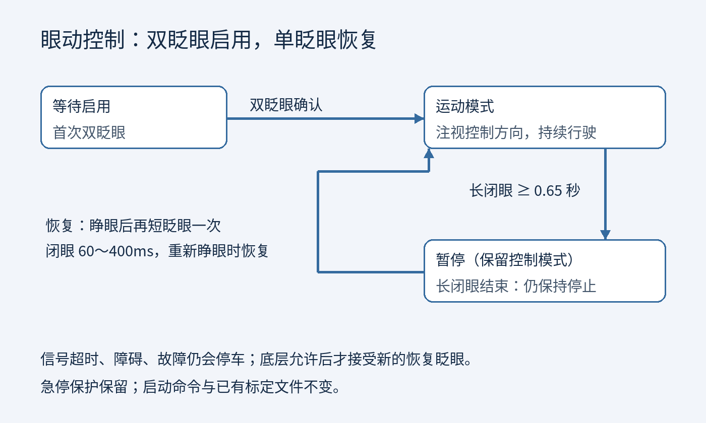

# RITnet 预训练模型部署

> **2026-10-14 更新：默认已切换三维眼球估计 + 一次正前方确认。** 启动、保存参考、移位处理及限制见 [GAZE3D.md](GAZE3D.md)。下文原三点标定对应 `--gaze-method legacy`。


当前推荐使用 RITnet + TensorRT FP16。官方模型直接输出背景、眼白、虹膜、瞳孔四类分割；无需手工选眼睛区域或采集闭眼模板。左眼沿用旋转 180° 的安装修正。

## 启动

仅左眼模型预览和 ROS 信号输出（不启动海龟）：

```bash
cd /home/whill/projects/EYETLE
./start_ritnet.sh
```

两只眼睛都已安装并连接时：

```bash
./start_ritnet.sh --eyes both
```

模型配合海龟控制器：

```bash
./start_eye_turtle.sh --ritnet             # 左眼
./start_eye_turtle.sh --ritnet --eyes both # 双眼
```

同一时间只运行一个入口。旧模板入口 `--dual` 保留，但推荐使用 `--ritnet`。

1. 佩戴并确认分割覆盖实际眼睛：红色瞳孔、绿色虹膜、蓝色眼白，黄色点为瞳孔中心。模型启动即开始识别，无需按 R 或 B。
2. 首次启动按顺序标定：看左时按 `A`（或 `1`）**开始采样**，保持注视，等待进度到 `60/60`、提示保存成功；然后看正中按 `S`（或 `2`）；最后看右按 `D`（或 `3`）。每一步自动保存并提示下一步，下一步仍等你按对应键开始，不会在转移视线时自动采样。按键后有 0.4 秒准备时间，随后仅计入新的、有效的睁眼帧；晃动时继续等待稳定样本，眨眼/丢失的帧不计入。通常每步约 3 秒。
3. 显示 `calibrated=True`、`valid=1` 后，首次双眨眼启用并前进；前进时左右注视转向；长闭眼约 650 ms 进入暂停。没有后退功能。单眼模式只能检测该眼，双眼模式要求两眼状态一致（短暂不同步允许最多 100 ms 过渡）。
4. 完整参数自动写入 `state/ritnet-calibration.json`。以后正常启动会显示 `Saved calibration loaded`，不必重复标定；无窗口运行也会加载。
5. `C` 重新标定（或启动时加 `--recalibrate`）；重标定期间暂停控制，完成后替换旧参数。未完成就退出时保留上次完整有效参数。首次标定仅完成部分方向时，会保存草稿，下次接着未完成的方向继续。Esc 或 Ctrl+C 退出。

可以用 `--left-camera`、`--right-camera` 指定设备，`--left-rotation` / `--right-rotation` 指定 0/90/180/270°。设备默认按 USB 端口路径排序，当前 4.4.1 是左眼，4.4.2 是右眼。

## 行驶、暂停与单次短眨眼恢复（2026-10-13 更新）

- 初次双眨眼启用控制，正常行驶不再每 5 秒强制停止。
- 长闭眼约 0.65 秒进入 `PAUSED`，保留控制模式；睁眼或再次双眨眼不会自动继续。
- 暂停后先睁眼，再完成一次 **60～400毫秒的短眨眼**，重新睁眼时恢复运动。长闭眼结束本身不会恢复，左右注视也不会恢复。
- 过短闭眼、超过400毫秒的闭眼、无效输入、超时或底层阻断会取消本次恢复；安全条件恢复后需重新眨眼。
- 相机／信号恢复只回到等待确认，不自动行驶。输入超时、障碍、急停、状态过期和仿真时钟保护仍有效；轮椅故障解除后必须收到底层允许恢复的反馈，再接受新的短眨眼。
- 海龟 `/eye_turtle/stop` 紧急停止会撤销控制模式，需要再次双眨眼启用。海龟边界停车和自动回中保留。
- 界面通过 `/eye_control/feedback` 显示“先睁眼 / 眨一次眼恢复 / 重新睁眼恢复”。只开预览而未开控制器时显示 `NO_CONTROLLER`。

启动方式、标定文件和正常方向控制方式保持原有入口。海龟一秒转向脉冲与轮椅持续侧向转动仍是各自的方向控制逻辑。本次修改通过自动化和 ROS 测试，真实用户体验及实体设备验收仍需单独进行。

## 参数复用

参数按相机 USB 端口、安装旋转角度、采集分辨率及模型引擎指纹匹配。单眼与双眼入口共享同一相机的参数；增加第二台相机时只补采尚未标定的那台。更换端口、旋转方向、分辨率或模型后，不会误用旧参数。

保存的是当前用户、当前佩戴位置的标定。软件重启或电脑重启不需要重新标定；换人、移动镜头或重新佩戴导致位置明显改变时，按 C 重标定。程序不能自动判断所有佩戴位移，因此若中心注视已有偏差，也应重标定。

多位用户可用 `--calibration-file state/USER.json` 保存独立档案。采样帧数可用 `--calibration-samples 60` 修改，按键后的准备时间可用 `--calibration-settle 0.4` 修改。样本使用中位数，P90–P10 跨度需不超过图像宽度的 2.5%，且左右端点须位于中心两侧、距离足够；不满足时会提示重试。

写入使用临时文件和原子替换，保存失败会暂停控制并提示按 Enter 重试。参数文件不包含眼睛图片。旧版只在内存中标定，已退出的旧版参数无法补存；需要使用新版完成一次标定。

## 模型、速度与精度的含义

- 使用 [作者官方 RITnet 仓库](https://github.com/AayushKrChaudhary/RITnet) 的 `best_model.pkl`，248,900 参数，MIT 许可。固定提交及 SHA256 在 `models/ritnet/*.json`，许可在 `models/ritnet/LICENSE.txt`。
- [论文](https://arxiv.org/abs/1910.00694) 报告 OpenEDS 上约 95.3% 的分割指标及 GTX 1080 Ti 上超过 300 Hz。这些不是当前相机的视线准确率，也不是本机帧率。
- 当前先用 640×480 全图模型定位眼睛，再自动截取 320×240 的原始像素区域推理，保留瞳孔像素尺寸。不是把整张图缩到 320×240（该方式在保存的佩戴图像上分割较差）。跟踪丢失后自动重新找眼睛；眼睛区域过大时保留全图推理。可用 `--full-frame` 关闭自动区域优化。
- 官方 gamma 0.8、CLAHE、归一化预处理保留；使用 TensorRT FP16 执行。双眼跟踪时合并为 batch=2 推理；只在眼睛区域内做 CPU 后处理。运行时无需安装 PyTorch，导出环境与现有 ROS / MediaPipe 环境隔离。
- 相机使用 4 个驱动缓冲区保证 USB 采集与解码重叠，独立线程持续读取，主线程只处理最新帧。预览最多刷新 15 次/秒，每次处理新相机帧都执行检测与 ROS 发布，绘图仍会产生额外开销。超过 250 ms 的旧帧无效；双路时间差超过 80 ms 无效。USB 相机没有硬件同步。
- 模型不是直接输出“眨眼”或屏幕坐标的模型。眨眼由分割区域消失、近期睁眼记录、周围图像稳定性组合推断，仍是启发式判断；最多沿用 80 ms 单眼未知状态。持续跟踪丢失不会直接当作有效长闭眼。
- 分割置信度不等于实际准确率。尚需真实佩戴视频及人工标注才能测定眨眼误触发率、方向识别率、瞳孔中心误差。焦距、反光、遮挡和光照变化会影响效果，不能保证所有佩戴条件下高精度。

## 复现与验证

```bash
./tools/build_ritnet.sh
source eye_ros_env.bash
.venv/bin/python -m unittest discover -s test -p 'test_*.py'
./start_ritnet.sh --no-display --max-frames 180 --report model-results/live-left.json
./start_ritnet.sh --eyes both --no-display --max-frames 180 --report model-results/live-both.json
.venv/bin/python tools/benchmark_ritnet.py IMAGE_PATH --output model-results/image
```

TensorRT engine 需在目标 Jetson 上构建。构建工具使用官方源；如 PyPI 下载较慢，可在构建前设置 `PIP_INDEX_URL=https://pypi.tuna.tsinghua.edu.cn/simple`。

测速报告分别记录单眼推理耗时（含预处理及数据拷贝）、整轮处理耗时、相机实际处理帧率、读取后帧龄。帧龄不包含曝光与 USB 传输延迟，不能当作完整端到端延迟。识别帧数不等于有人工真值的准确率。

## 本机验收记录（2026-10-10，Orin / MAXN）

- 双眼不显示窗口：240 对图像，28.09 对/秒；每眼分摊推理中位数 10.67 ms、P95 15.00 ms；整轮处理 P95 42.17 ms。
- 双眼带窗口：150 对图像，检测/发布 21.86 对/秒；预览实际刷新约 11 次/秒；读取后的帧龄 P95 73.20 ms，不含曝光/USB 延迟。
- 原始 FP32 与 FP16 输出一致性：全图标签一致率 99.973%；单眼区域 99.945%；双眼批处理 99.953%。这是模型转换一致性，不是对人工真值的准确率。
- 27 项算法、控制器及标定保存/加载测试通过；真实 ROS 接收确认未标定时全部输出无效信号。
- 佩戴采集中两眼都出现了 OPEN/CLOSED 状态，但未同步人工标注，因此不能据此报告眨眼准确率。左右方向控制需要完成三点标定后现场验收。

详细 JSON 记录位于 `model-results/live-both.json`、`live-both-gui.json`、`parity-fast.json`、`parity-crop.json`、`parity-batch.json`；模型和引擎指纹见 `models/ritnet/`。

### 暂停恢复改版验证（2026-10-13）

单眨眼改版：EYETLE 31 项、轮椅工作空间 66 项自动化测试通过，覆盖长闭眼不误恢复、短闭眼噪声、输入中断、障碍锁止与恢复握手。尚未进行实车或佩戴者准确率验证。

当前图示：
